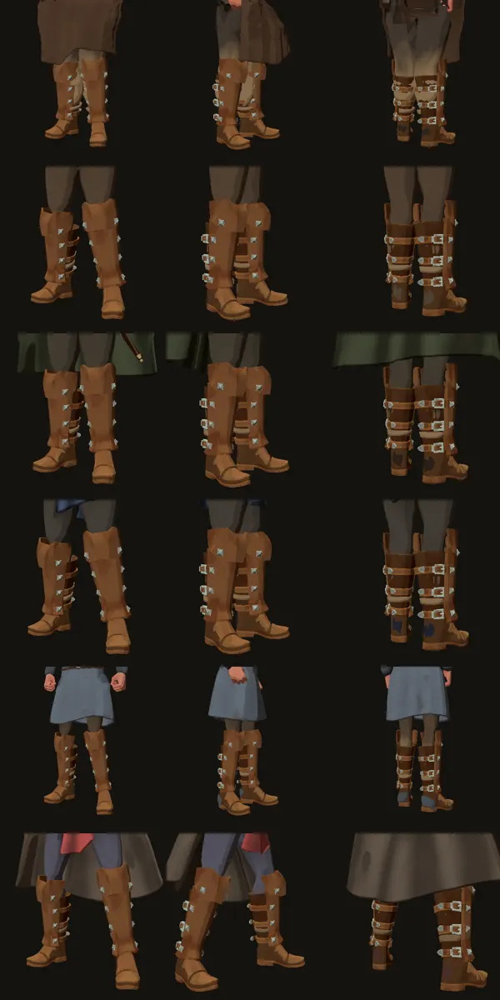

# 1650 · Hose sticht nicht mehr durch den Stiefelschaft (Bram, Garrick, Jorin, Wache)

Tom · 18.11., 15:34 · E Figuren · aus der Durchstechprüfung 1631 (Lauf 560)
Kurz: Die Hose liegt jetzt im Schaft. Bei Bram, Garrick, Jorin und der Wache sticht sie dort nicht mehr durch. Bei Borin und Pim ist es noch nicht gelöst (siehe „Offen“).

Geprüft an: https://github.com/tramour-cmyk/androidapp_rpg_bornim/commit/09a528b1b (`claude/tom-1650-stiefel`), Kaufbau am Rechner, Messung `durchstich_1631`, Bild am Rechner in „Stehen“

**Gemessen** (Ecken, die in der Bewegung vor einer anderen Lage liegen, „Stehen“, vorher → jetzt): Bram 182 → 100, Garrick 187 → 104, Jorin 179 → 97, Wache M 388 → 346. Was dort bleibt, ist der Stiefel gegen sich selbst (Riemen über dem Schaft, Bauart des Kaufstiefels) und bei der Wache das Kettenhemd am Umhang (1651).

**Offen:** (1) Borin 196 → 216: Sein helles Beinkleid liegt teils über dem Schaft, dort sticht jetzt der Stiefel hindurch (Knöchel und Wade). (2) Pim 109 → 106: Am Knöchel liegt die Hose noch vor dem Stiefel, hinten sieht man dunkle Flecken an der Ferse. Beides baue ich als Nächstes nach; die Schwelle der Prüfung senke ich erst, wenn alle sechs nicht schlechter sind.

👍 so weiter (Borin und Pim nachbessern, dann in den Sammelbuild) · 👎 sieht falsch aus (bitte sagen, was)
