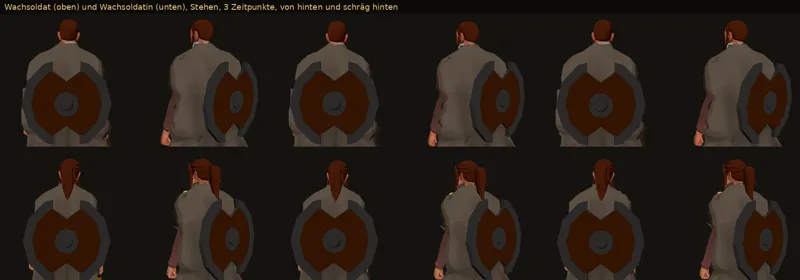

# 1651 · Wache: sticht das Kettenhemd durch den Umhang?

[Bild von 18.11., 16:47](https://github.com/tramour-cmyk/androidapp_rpg_bornim/blob/bilder/2026-11/18-1647-1651-Tom.png) (eingetragen von meldung.sh, Tom)

Tom · 18.11., 16:48 · E Figuren · aus Toms Durchstechprüfung 1631 (Lauf 560)
Kurz: Die Prüfung meldet das Kettenhemd an der Schulter vor dem Umhang (1,3–1,5 m); im Bild von hinten und schräg hinten liegt der Umhang an Schulter und Rücken geschlossen über dem Kettenhemd, bei beiden Wachen. Die Meldung kommt von der offenen Vorderseite des Umhangs, wo das Kettenhemd ohnehin zu sehen ist. Nichts zu bauen.

Geprüft an: https://github.com/tramour-cmyk/androidapp_rpg_bornim/commit/c2f5499da (`claude/build-299`), Bild am Rechner mit Kaufmodellen (Probe 1651), Ruhebewegung Stehen, drei Zeitpunkte

- 👍 passt: am Rücken und an den Schultern nur Umhang, kein Kettenhemd darüber → 1651 erledigt ohne Bau.
- 👎 falsch: Kettenhemd sticht irgendwo durch den Umhang (bitte Stelle nennen).
