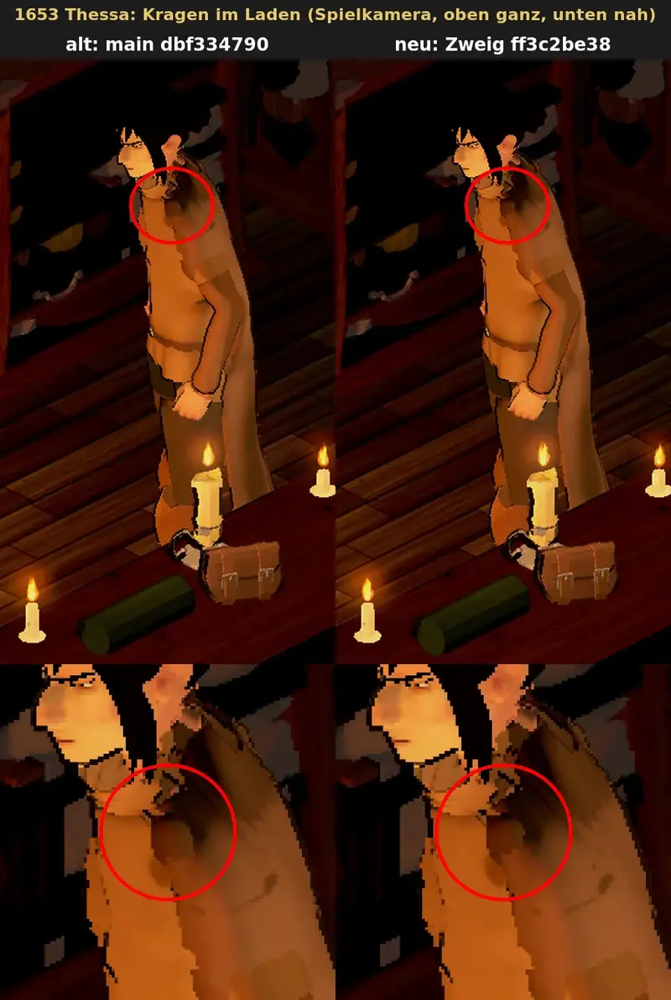

# 1653 · Thessa: Kragen, alt gegen neu (Spielkamera)

[Bild von 23.11., 20:29](https://github.com/tramour-cmyk/androidapp_rpg_bornim/blob/bilder/2026-11/23-2029-1653-Uwe.webp) (eingetragen von meldung.sh, Uwe)

Silke · 23.11., 19:48 · E Figuren · gemeinsam mit 1654 (Rowena)
Kurz: Thessa im Laden hinter dem Tresen, Spielkamera 1080×2340, nächster Fingerzoom, Ruhebewegung „Greifen“; oben ganz, unten der Kragen nah; Stelle rot.

Geprüft an: https://github.com/tramour-cmyk/androidapp_rpg_bornim/commit/ff3c2be38 (`claude/jerry-1653-kleid`, mit `main` dbf334790 gemischt), am Rechner aus dem Kaufrepo gebaut; alt = `main` dbf334790. Ein Bildlauf (`godot/tests/bild_1653.gd`).

- Gemessen (`durchstich_1631`, alle 31 Figuren): die Spangen am Kragen (`Kleid#16>Kleid#14`, 1,4–1,5 m) stechen in keiner Bewegung mehr durch; was bei Thessa bleibt, liegt an den Stiefeln (0,2–0,5 m).
- Im Bild: am Kragen sticht nichts durch. Alt und neu unterscheiden sich in der Spielkamera nur um wenige Bildpunkte am Umhangrand unter dem Kinn.

| Figur | Bewegung | durch alt | durch neu |
|---|---|---|---|
| Thessa | Stehen | 24 | 19 |
| Thessa | Ruhe am Tresen | 24 | 15 |
| Thessa | Gesten | 27 | 21 |
| Thessa | Greifen | 34 | 20 |
| Rowena | Stehen | 9 | 5 |
| Rowena | Ruhe am Tresen | 31 | 9 |
| Rowena | Gesten | 13 | 9 |
