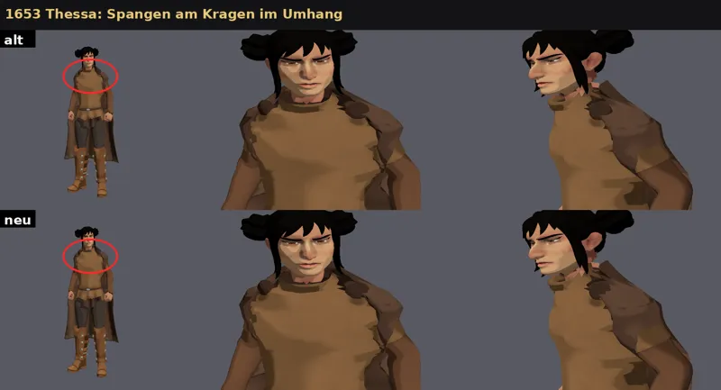

# 1653 · Thessa: Spangen am Kragen, alt gegen neu

 (Großbild: Telegram 18.11. 22:28)

Jerry · 18.11., 22:28 · E Figuren · aus deinem Wort 21:48 („das sind ja keine Bilder“), Befund war „sichtbar“
Kurz: Thessa, ganz (Stelle rot markiert) und Kragen nah von vorn und 50°, oben alt, unten neu.

Geprüft an: https://github.com/tramour-cmyk/androidapp_rpg_bornim/commit/711c18da6 (`claude/jerry-1653-kleid`), am Rechner gebaut und gemessen (`durchstich_1631`: 34 → 20 Ecken, die Spangen stechen nicht mehr durch den Umhang)

- Ursache: die goldenen Spangen saßen halb im Umhang und stachen in der Bewegung durch ihn; ihre Teile unter dem Umhang sind weg.
- Offen: im Standbild sieht alt wie neu aus, das Durchstechen kam nur in der Bewegung („Ruhe, Greifen“); ein Bild dieses Moments und die Spielkamera in Handygröße kommen mit dem nächsten Lauf (Probe für 1653 verbraucht).
- 👍 passt: so lassen, in den nächsten Build.
- 👎 falsch: sichtbar anders als gedacht.
