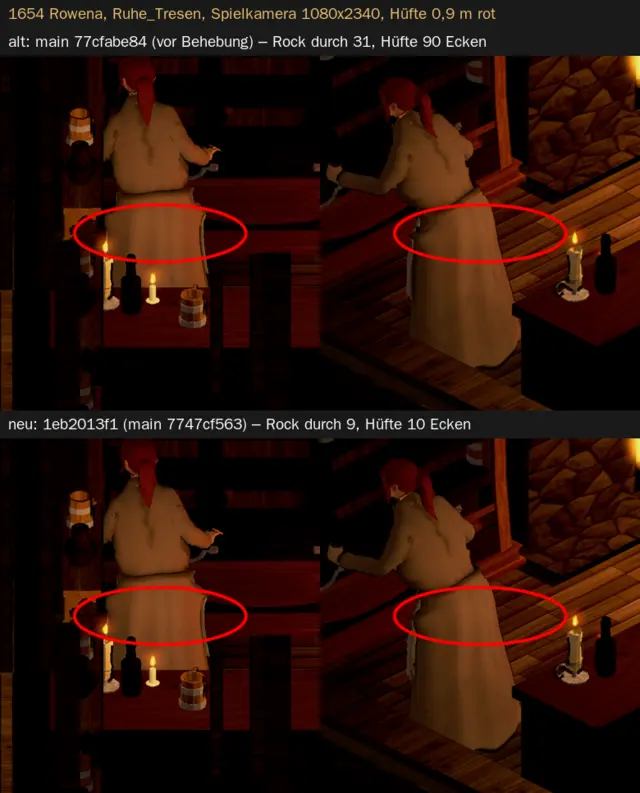

# 1654 · Rowena: Rock auf der Schürze an der Hüfte, alt gegen neu

 (Großbild: Telegram 18.11. 22:28)

Jerry · 18.11., 22:28 · E Figuren · aus deinem Wort 21:48 („was ihr von mir wollt“), Befund war „sichtbar“
Kurz: Rowena, ganz (Stelle rot markiert) und Hüfte nah von vorn und 50°, oben alt, unten neu: die braunen Zacken auf der Schürze sind weg.

Geprüft an: https://github.com/tramour-cmyk/androidapp_rpg_bornim/commit/711c18da6 (`claude/jerry-1653-kleid`), am Rechner gebaut und gemessen (`durchstich_1631`: 31 → 9 Ecken)

- Ursache: an der Hüfte lagen Rock und Kittel über den Rändern der Schürze; dort, wo die Schürze deckt, sind sie jetzt weg.
- Offen: von der Seite bleibt ein kleiner brauner Rest am Rand; Spielkamera in Handygröße mit dem nächsten Lauf.
- 👍 passt: so lassen, in den nächsten Build.
- 👎 falsch: noch Zacken zu sehen.
