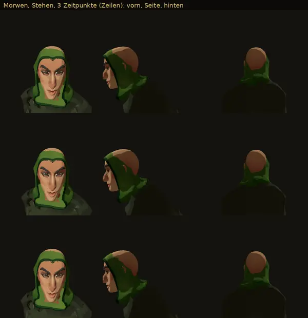

# 1655 · Morwen: sticht der Kopf durch die Kapuze?

Tom · 18.11., 17:06 · E Figuren · aus Toms Durchstechprüfung 1631 (Lauf 560)
Kurz: Ja. Morwen in der Ruhebewegung Stehen, drei Zeitpunkte, Kopf von vorn, Seite und hinten: Oben und hinten schaut der Kopf (Haut) durch die Kapuze. Das ist ein Fehler, ich baue die Behebung (Kapuze weiter oder Kopf darunter einziehen) und zeige danach alt gegen neu.

Geprüft an: https://github.com/tramour-cmyk/androidapp_rpg_bornim/commit/c2f5499da (`claude/build-299`), Bild am Rechner mit Kaufmodellen (1655, Läufe frei 17:01)

- Offen: Behebung und Bild alt gegen neu.
