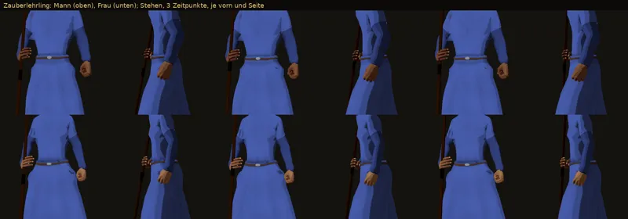

# 1657 · Zauberlehrling: stechen die Hände durch die Robe?

Tom · 18.11., 16:54 · E Figuren · aus Toms Durchstechprüfung 1631 (Lauf 560)
Kurz: Die Prüfung meldet die Hände in der Robe (0,9–1,0 m). Im Bild hängt die freie Hand neben der Robe, die Stabhand hält den Stab; bei der Frau zeigt sich neben der Faust ein kleiner dunkler Fleck auf der Robe (wohl der Knöchel knapp in der Robe). Sonst nichts sichtbar.

Geprüft an: https://github.com/tramour-cmyk/androidapp_rpg_bornim/commit/c2f5499da (`claude/build-299`), Bild am Rechner mit Kaufmodellen (Probe 1657), Ruhebewegung Stehen, drei Zeitpunkte

- 👍 passt: so lassen, der Fleck stört nicht → 1657 erledigt ohne Bau.
- 👎 falsch: Fleck oder Hand in der Robe stört → Robe an der Hand der Frau zurücknehmen.
