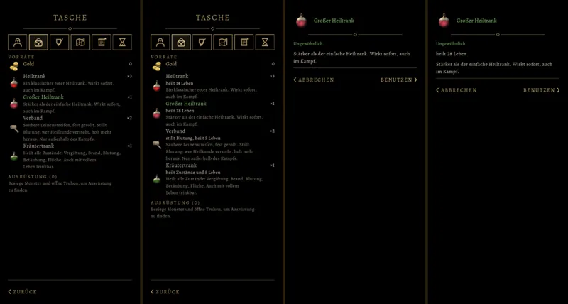

# 1663 · Wirkung in Tasche und Detailansicht

Tom · 18.11., 14:29 · E Oberfläche · Fund des Chefs 14:17 (Bild): Beutel und Detailansicht ohne Wirkung
Kurz: Die Kurzzeile aus dem Laden („heilt 28 Leben“, ohne Würfel) steht jetzt auch in der Tasche, im Fenster des Gegenstands und im Mengenkasten des Ladens, hell über dem Langtext.

Geprüft an: https://github.com/tramour-cmyk/androidapp_rpg_bornim/commit/da29670e3 (`claude/tom-1663-wirkung`), Bild am Rechner wie im Menü; Logik 192/0, `laden_582` prüft die Zeile

👍 passt: Wirkung in Tasche und Fenster lesbar, ohne Würfel · 👎 falsch: Zeile fehlt, falsche Zahl oder stört (bitte sagen, was)
