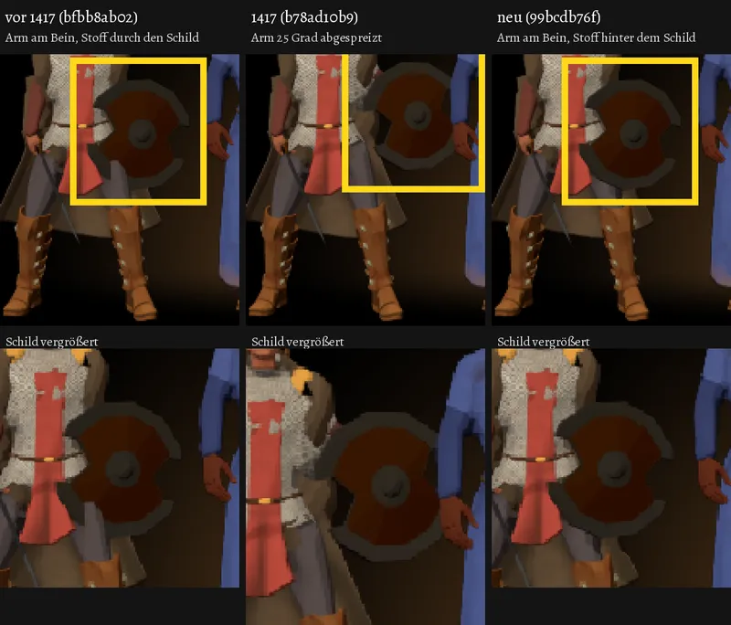

# 1675 · Wachsoldatin im Hauptmenü, Schild schwebt neben ihr · Figur · 23.11., 18:08

Links vor 1417 (`bfbb8ab02`), Mitte heute auf main (`b78ad10b9`), rechts neu (`99bcdb76f`, Zweig `claude/figur-1675-schild`). Prüfer Rudi hat mit ja geprüft: Schild vor dem Körper wie vor 1417, ganz sichtbar, keine graue Spitze, kein Stoff darüber.

Dein Urteil: Hält die Wachsoldatin den Schild jetzt wieder vor dem Körper, ganz sichtbar, ohne dass etwas durchscheint? 👍 gut, 👎 nein mit einem Wort.
