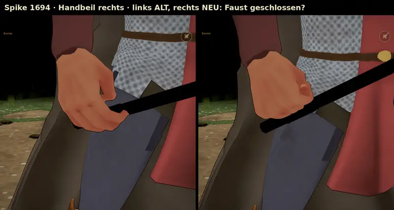

# 1694 · Griff für alles Gehaltene: schließt die Faust jetzt um den Stiel?

Spike · 18.11., 17:31 · E Technik · aus deinem Wort 17:01 („Als Systemlösung“), Funde 1621 (Zweihänder) und 1657 (Stab)
Kurz: Handbeil in der rechten Hand, nah an der Hand, links alt, rechts neu. Alt: Fingerspitzen 2–3 cm vor dem Stiel, die Faust offen. Neu: Stiel in der Faust, jeder Finger bis an den Stiel gebeugt.

Geprüft an: https://github.com/tramour-cmyk/androidapp_rpg_bornim/commit/e2deb8691 (`claude/spike-1694-griff`), Messung `griff_mess_1694` am Rechner mit Kaufmodellen (Fingerkuppe am Schaft: Handbeil, Schwert, Stab je 0,8–1,3 cm Knochen bis Oberfläche, vorher 2–3 cm)

- Bekannt: die Waffe ist im Bild schwarz, weil am Rechner der Grafikweg des Handys (Vulkan) fehlt; im Spiel farbig.
- Offen: Stab im Stehen (Finger bleiben gestreckt), linke Hand am Zweihänder, Kampfort und Leute nutzen den Weg noch nicht; Bild in Spielkamera folgt mit dem Lauf auf dem Bauserver.
- 👍 passt: so weiter für alle Hände (Stab, Zweihänder, Kampfort, Leute).
- 👎 falsch: Faust schließt nicht oder sieht verkrampft aus (Finger nennen).
