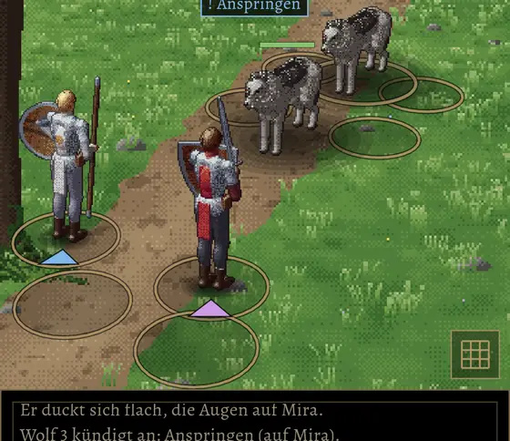

# 229.3 · Raster und Ringe auf Stand Build 44 · Jerry · 20.10., 15:20

Dein „ja, okay“ (14:50) mit der Bitte zu prüfen, dass kein Zugkreis eine Figur überdeckt.

- Nur die Rasterlinien aus dem Zweig übernommen (dunkler Grund, dunkler Rand, kräftige Goldlinie); Schatten, Ringe, Namen, Plätze wie in Build 44.
- Ringe: Sie wurden je Figur von hinten nach vorn gezeichnet, der Ring einer näheren Figur konnte die Beine einer dahinter stehenden verdecken. Jetzt liegen alle Ringe zuerst am Boden, alle Figuren darüber.

*Stärkstes Gegenargument:* Steht ein Gegner eng hinter einem anderen, liegt sein Ring jetzt teils unter dem vorderen und ist dort nicht zu sehen; dafür bleibt jede Figur ganz sichtbar.

Nach „passt“ in Build 45 (Zweig `claude/jerry-245-1-rennen`).
