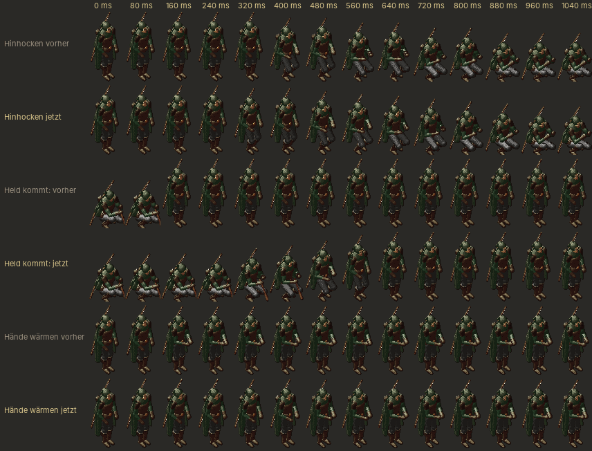

# 239 · Haltungswechsel weich (Garrick, Leute bei der Arbeit) · Tom · 20.10., 12:19

Dein Hinweis 11:45: „Animationsübergang bei Garrick (sitzen/stehen) sehr unrund. Vielleicht grds mal schauen bei animationen, dass sie weich ineinander übergehen.“

Ein Bild alle 80 ms, jeweils oben vorher, darunter jetzt:
1. **Hinhocken:** vorher 4 Stufen (10 cm je Bild), jetzt 8 Stufen.
2. **Held kommt:** vorher stand Garrick in einem einzigen Bild auf; jetzt steht er in gut einer halben Sekunde aus der Haltung auf, in der er gerade ist, und hockt sich erst beim nächsten Mal wieder hin (vorher ruckte er beim Weggehen des Helden mitten in die Hocke zurück).
3. **Hände wärmen:** vorher sprangen die Hände in einem Bild ans Feuer; jetzt gleiten sie hin und zurück. Gilt auch für Spähen, Rowenas Wischen und Einschenken; die Schleifen selbst haben dreimal so viele Bilder.

Durchgesehen: Borin am Tisch (jetzt auch 8 Stufen), Gesten, Stehen, Speer abstellen waren schon weich; der Sprungtest prüft jetzt auch Garricks Hocke, das Aufschrecken und alle Schleifen: 0 Sprünge.

Setzt Jerrys Vorschlag (12:10, „alle drei“) um; seine Datei entfällt. *Stärkstes Gegenargument (Jerry):* das Hochschrecken in einem Bild war gewollt („er schreckt auf, wenn der Held kommt“, 10.10.); mit 0,55 s wirkt er ruhiger.

**Antwort:** „passt“ (fährt im nächsten Tom-Build, mit 215.1 Klopfen), „Hochschrecken bleibt“ (nur 1 und 3) oder „nein“. Zweig `claude/tom-239-haltungswechsel`.
