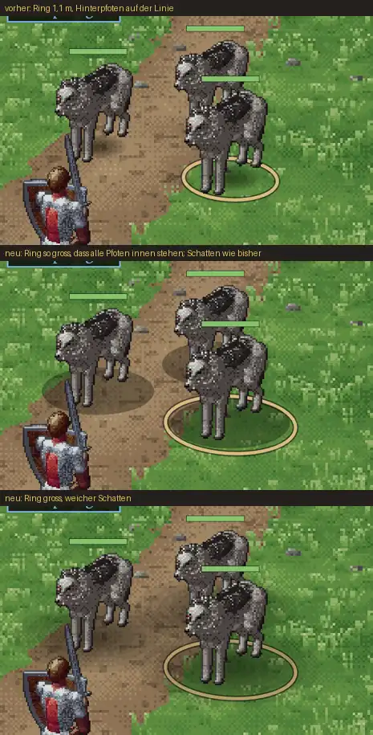

# 242.1 · MARS: Tiere stehen im Ring; Schatten wirklich weich
Jerry · 20.10., 12:45 · E Kampf · M (Chef 12:32: „… bei den Monstern, ist der Ring nicht richtig. Da steht die Figur nicht richtig auf dem Ring. Also das gehört natürlich für beide Kampfsysteme richtig gestellt“)

**Ring.** Nachgemessen: Helden, Goblins und Grak stehen mit den Füßen mittig, der Ring ist hinter ihren Beinen unterbrochen. Falsch waren nur die Vierbeiner (Wolf, Eber, Ratte). Sie stehen zwar mittig, sind aber von der Vorder- bis zur Hinterpfote etwa 1 m lang, und der Ring hatte nur 1,1 m Durchmesser. Darum standen die Hinterpfoten genau auf der Linie. Neu: Der Ring eines Tiers ist so groß, dass alle vier Pfoten darin stehen, mit 30 cm Luft.

**Schatten, Fehler von mir:** Das Bild „vorher/weich“, auf das du um 12:37 „Schatten passt“ gesagt hast, zeigte unten keinen weichen Schatten. Mein erster Versuch erschien als harter schwarzer Fleck. Jetzt ist er wirklich weich (dunkel unter den Füßen, zum Rand ganz durchsichtig), bei Tieren so lang, wie sie stehen. Bitte noch einmal ansehen: unterste Zeile.

**Klassischer Kampf:** Dort gibt es keinen Ring. Der Schatten unter Held und Gegner ist noch das alte Oval, dort habe ich nichts geändert.

Zweig `claude/jerry-242-ring`. Fährt in Build 43 mit (dazu 237, 240, 241).

**Antwort:** „passt“, oder was ändern.
