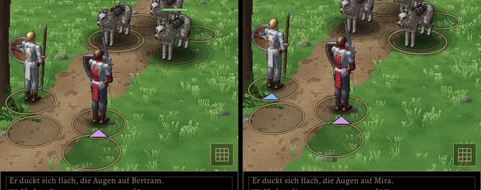

# 242.4 · Unten Luft für Ring und Zielmarke · Jerry · 20.10., 15:24

Dein Hinweis 15:16: „Der Angriffsmarkierer ist knapp zu sehen. Können wir die Markierer ggf. ein paar Pixel allgemein anheben …?“

Nach dem Vorschlag von Sokrates nicht die Marken anheben (dann rücken sie bei allen in die Figur), sondern den Kampf etwas höher ins Bild: die Mitte des Kampfes liegt jetzt bei 64 % statt 68 % der Bildhöhe, alles steht etwa 22 Bildpunkte (A56) höher, unten bleibt Boden für Ring und Dreieck der vordersten Figur. Kulisse, Winkel und Größen bleiben gleich.

Links vorher (68 %), rechts jetzt (64 %), Raster an:

*Stärkstes Gegenargument:* Oben verschwindet entsprechend etwas Kulisse (Baumkronen, Höhlendecke); der in 211.13 abgenommene Ausschnitt ändert sich leicht.

Nach „passt“ in Build 45 (Zweig `claude/jerry-245-1-rennen`, mit 245.1, 229.3, 241.2).
