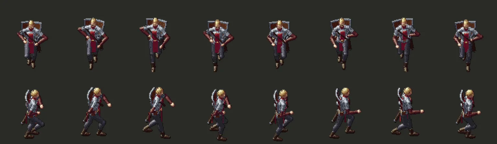

# 245.1 · Rennen mit Flugphase · Jerry · 20.10., 15:20

Dein Test 44.5 (15:03): „das Rennen sieht aus, wie wenn Trump tanzt … wie ein falscher Moonwalk … Rennen hat auch was damit zu tun, dass sich die Beine irgendwie vom Boden heben“.

Ursache: Die Füße glitten im Sinus vor und zurück und blieben immer am Boden; das linke Bein bewegte sich nur ein Drittel so weit wie das rechte.

Jetzt (oben von vorn, unten von der Seite, jedes zweite der 16 Rennbilder):
- Ein Fuß trägt und wandert unter der Hüfte nach hinten, der andere hebt ab, die Ferse schwingt hoch, dann geht er angehoben nach vorn.
- Zweimal je Doppelschritt sind beide Füße kurz in der Luft, der Körper hebt sich dabei um etwa 6 cm; beim Aufsetzen geben die Knie nach.
- Beide Beine gleich weit; 16 statt 12 Bilder, damit nichts springt (Sprungtest 0).

Gehen bleibt wie in Build 44. Bewegtbild in Echtzeit per Telegram.

*Stärkstes Gegenargument:* Die Füße rutschen bei Renntempo noch etwas (die Spielfigur läuft 3 Felder je Doppelschritt, weiter, als ein Bein reicht); ganz ohne Rutschen müsste der Held langsamer rennen.

Nach „passt“ in Build 45 (Zweig `claude/jerry-245-1-rennen`).
