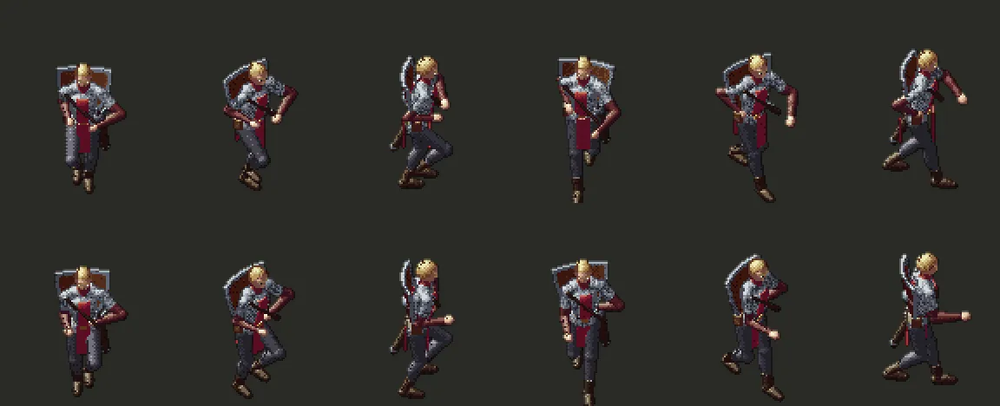

# 245.2 · Ellbogen nach hinten · Jerry · 20.10., 15:33

Dein Hinweis 15:27: „dass die Arme nicht so seitlich da schaut, also als ob er abheben will und mit den Flügeln schlägt … wenn wir es jetzt anpacken, dann vielleicht mal richtig.“

Ursache: Die Ellbogen beugten sich immer nach außen und hinten (Haltung aus dem Kampf). Jetzt beim Gehen halb, beim Rennen fast ganz nach hinten am Körper entlang, die Hände beim Rennen etwas näher zur Mitte. Gilt auch für die Leute im Dorf, wenn sie gehen. Stehen und Kampf unverändert; eine geschulterte Waffe bleibt, wie sie war.

Rennen, vier Momente (je von vorn, schräg, Seite); Bewegtbild Rennen und Gehen per Telegram:

*Stärkstes Gegenargument:* Von vorn sieht man die Arme jetzt weniger schwingen, sie liegen hinter dem Körper.

Nach „passt“ in Build 45 (Zweig `claude/jerry-245-1-rennen`).
