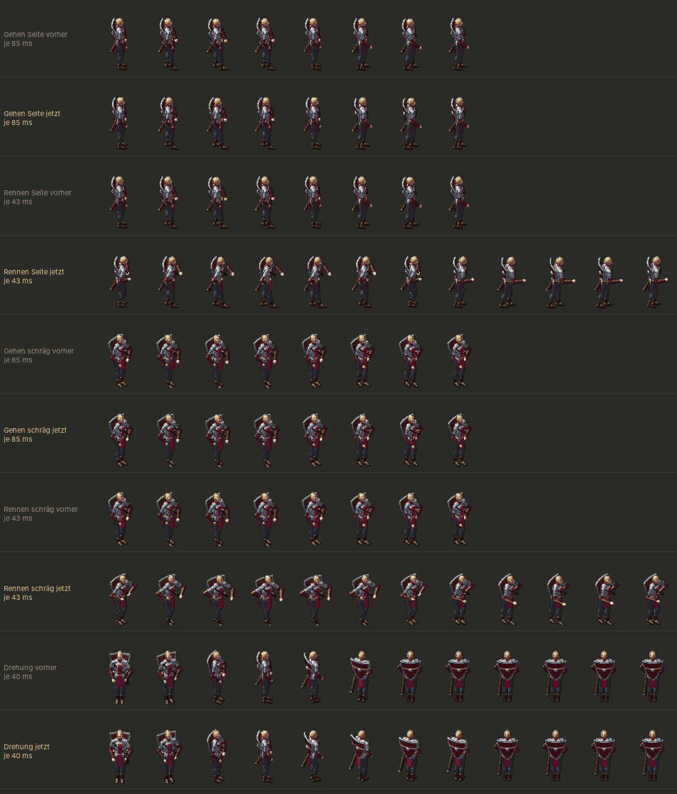

# 245 · Held läuft weniger „robotermäßig“ · Jerry (Übernahme von Tom) · 20.10., 13:00

Tester über dich (12:24): „der Held … vor allem wenn er dann rennt, sehr robotermäßig … Drehungen, dass die weicher werden … Gehen, schräger Laufen auch.“

Gefunden: der Oberkörper bewegte sich beim Gehen gar nicht mit (nur Beine und Arme); Rennen waren dieselben 8 Gehbilder doppelt so schnell (Beine trippeln, ein Doppelschritt in 0,34 s); Drehung mit fester Geschwindigkeit, hält hart an.

Je oben vorher, darunter jetzt, ein Bild je Schritt, wie das Spiel sie zeigt (Seite und schräg):
1. **Gehen:** Schulter schwingt gegen den vorderen Fuß (bis 7°), Kopf schaut ruhig geradeaus, leicht vorgelehnt.
2. **Rennen:** eigene 12 Bilder auf 3 Felder: weiter vorgelehnt, längerer Schritt, Knie federn, Arme angewinkelt und höher, schwingen weiter; Doppelschritt 0,51 s.
3. **Drehung** (halbe Drehung, ein Bild je 40 ms): gleich schnell los, aber kommt weich an statt abrupt.

Gilt für den Helden; Leute im Dorf gehen mit Schulterschwung, rennen nicht. Sprungtest prüft Gehen, Rennen und Losgehen: 0 Sprünge.
Stil (`DESIGN-STIL.md`): „keine Sprünge zwischen Haltungen“; Übergänge Stehen ↔ Gehen ↔ Rennen im Sprungtest; Wechsel Gehen ↔ Rennen setzt im Spiel den Schritt fort (beim Bau).
*Stärkstes Gegenargument:* 192 Bilder mehr je Ausrüstung (Rennen), Vorzeichnen dauert länger; sie kommen nach den Gehbildern, bis dahin rennt er im Gehbild.

**Antwort:** „passt“ (Build mit Jerrys nächstem Build), „nur Gehen und Drehung“ oder „nein“. Zweig `claude/jerry-245-gang`.
