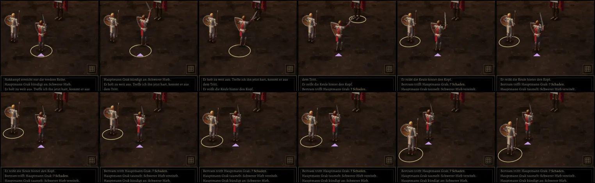

# 249 · MARS: Gleiten statt Springen, Hieb mit der Waffe · Jerry · 20.10., 16:22

Dein Hinweis 14:01: „wenn plötzlich von Reihe auf Linie umgeschaltet wird, egal bei wem, ist das sehr sprunghaft … es sind auch keine Angriffe animiert“. Erste zwei Teile aus der Liste zu 249:

- **Gleiten:** Ändert sich der Platz einer Figur (Wechsel, eine Reihe steht allein und rückt zur Mitte, ein Nachbar fällt), geht sie in 0,35 s weich dorthin, Ring und Dreieck mit; ein neuer Wechsel unterwegs beginnt, wo sie gerade ist. Neuer Sprungtest dafür.
- **Hieb:** Held und Söldner holen beim Ausfallschritt mit ihrer Waffe aus und schlagen zu (Bilder des klassischen Kampfs; Hieb, Stoß oder Schlag von oben je nach Waffe), dann zurück in die Ruhe.

Oben: Bertram schlägt Grak (Ausholen, Schritt vor, Treffer, zurück). Unten: Mira wechselt nach hinten, Bertram rückt allein zur Mitte. Aufnahme aus dem Spiel in Zeitlupe (×8), sonst wäre der Übergang zwischen zwei Bildern verschwunden:

*Stil:* Bewegung ohne Sprung, jede Aktion sichtbar ( „Selbst prüfen“). *Stärkstes Gegenargument:* Beim Gleiten stehen die Figuren still und rutschen; Schritte (Gang aus 245) brauchen eigene Kampfbilder unter der Kamera, das wäre der nächste Schritt. Kür neben Direktive 179.

Nach „passt“ im nächsten Jerry-Build (Zweig `claude/jerry-249-mars-gefuehl`, baut auf Build 46 auf).
