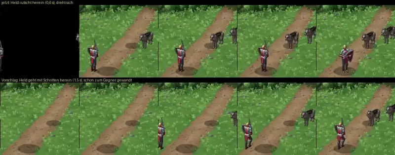

# 249 · Hereingang im klassischen Kampf · Jerry · 21.10., 10:13

Oben der jetzige Stand: Der Held rutscht in 0,6 s von links herein und dreht sich dann. Unten der Vorschlag: Er geht in 1,5 s mit denselben Schritten herein wie beim Platzwechsel in MARS (abgenommen 20.10., „249 passt“), schon zum Gegner gewandt, und dreht sich danach nicht mehr. Die Gegner kommen wie bisher von rechts. Auf Wunsch können Wölfe und andere Tiere dabei traben wie in MARS.

Bitte sagen: „249 Hereingang passt“ (dann baue ich ihn in den nächsten Build), „passt, Tiere auch“ oder was anders sein soll.
