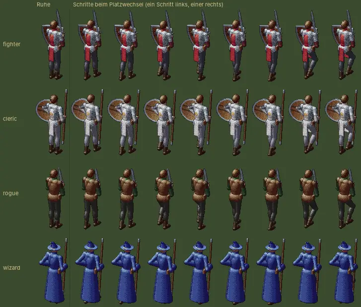

# 249 · MARS: Schritte statt Rutschen beim Platzwechsel · Jerry · 20.10., 16:59

Dein Wort 16:37: „Schritte als nächster Teil und das alte Kampf-System nicht vergessen.“

- **Schritte:** Wechseln Held oder Söldner den Platz, gehen sie in 0,35 s einen ganzen Schritt (ein Fuß, dann der andere), Knie heben, Oberkörper dreht leicht mit, Waffe bleibt in der Ruhehaltung. Gleiche Fußbahn wie der Gang aus 245, nur kürzer. Sprungtest grün.
- **Monster** (Wölfe rücken zur Mitte, wenn ein Nachbar fällt) gleiten vorerst weiter; Schritte für Tiere brauchen eigene Kampfbilder, das wäre der nächste Teil.

Bildblatt aus der Vorschau, Kampfkamera von MARS: links Ruhe, dann die acht Bilder eines Schritts, je Klasse eine Zeile (beim Magier verdeckt die Robe die Beine fast ganz):

**Klassischer Kampf, Befund:** Er hat keinen Platzwechsel; starr ist nur der Anfang: Held und Gegner rutschen in 0,6 s 260 dp herein, der Held dabei von vorn, erst danach dreht er sich zum Gegner (so gewollt, „der Hereingang wird nicht gespielt“). **Empfehlung:** dort der Held mit denselben Schritten herein, Drehung wie bisher danach; Bild davon, bevor gebaut wird. *Stärkstes Gegenargument:* Der Anfang ist kurz, der Hereingang verlängert ihn nicht, ändert aber die Eröffnung, die du schon abgenommen hast; Kür neben Direktive 179.

*Stil:* Bewegung ohne Sprung, jede Aktion sichtbar (`DESIGN-ABNAHME.md` „Selbst prüfen“). Nach „passt“ im nächsten Jerry-Build (Zweig `claude/jerry-249-schritte`, baut auf Build 47 auf).
