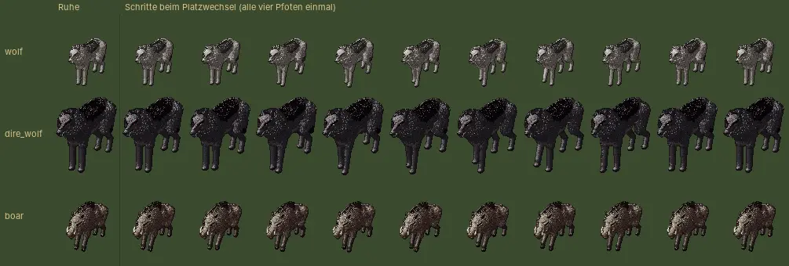

# 249 · MARS: Tiere gehen beim Platzwechsel · Jerry · 20.10., 18:46

Folgt auf die Schritte von Held und Söldner (Bild 249-schritte): Rückt ein Wolf, Wildschwein oder eine Ratte auf einen anderen Platz (etwa zur Mitte, wenn der Nachbar fällt), setzt es alle vier Pfoten einmal nacheinander, aus der Kampfhaltung heraus und wieder hinein, statt zu rutschen. Dieselbe Gangart wie auf der Karte.

Bildblatt aus der Vorschau, Kampfkamera von MARS: links Ruhe, dann die zehn Bilder des Schritts (Wolf, Schreckenswolf, Wildschwein, Ratte):

*Stil:* keine Figur rutscht, jede Bewegung ohne Sprung (`DESIGN-ABNAHME.md`, Sprungtest grün). *Stärkstes Gegenargument:* Kür neben Direktive 179; die Tiere gehen auf der Stelle, während sie gleiten, auch seitwärts (wie die Schritte der Helden). Nach „passt“ zu 249-schritte und diesem Bild im nächsten Jerry-Build (Zweig `claude/jerry-249-tiere`).
