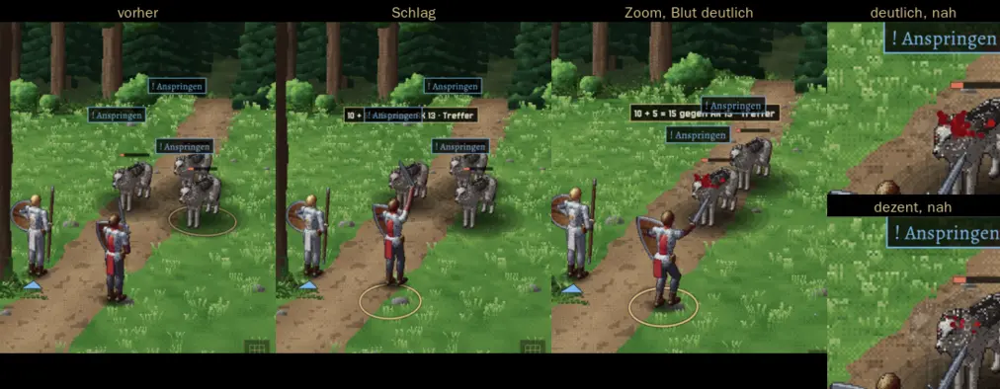

# 249 · MARS: Zoom, Erschütterung und Blut wie im klassischen Kampf · Jerry · 20.10., 17:32

Aus deiner Liste zu 249 (14:41): Heranzoomen bei kritischem Treffer und letztem Schlag, Erschütterung beim Einschlag, Blut. Gebaut aus den Teilen des klassischen Kampfs, nicht doppelt.

- **Zoom und Erschütterung:** Kritischer Treffer oder letzter Schlag: das Bild ruckt einmal in Schlagrichtung und zoomt kurz auf den Getroffenen (letzter Schlag etwas länger und näher), dann zurück. Bleibt im Kampfort, ragt nicht über den Bericht.
- **Blut:** Hieb, Biss und Schuss lassen Tropfen von der Brust des Getroffenen spritzen, weg vom Angreifer; dieselben Tropfen wie im klassischen Kampf, nach der Einstellung „Blut bei Treffern“ (Aus, Dezent, Deutlich), bei „Deutlich“ Spritzer am Boden. Zauber bluten nicht. Gilt für Gegner und Helden gleich.

Bilder aus der Vorschau (Söldner Bertram, letzter Schlag auf Wolf 1; Zeitlupe):

*Stil:* Blut ja, abgestuft über die Menüeinstellung, für Held und Gegner gleich (`DESIGN-STIL.md` Richtung); jeder Treffer sichtbar. *Stärkstes Gegenargument:* Kür neben Direktive 179; der Zoom bewegt auch Namen und Zeichen über den Figuren mit (wie im klassischen Kampf). Nach „passt“ im nächsten Jerry-Build (Zweig `claude/jerry-249-schritte`, mit den Schritten).
