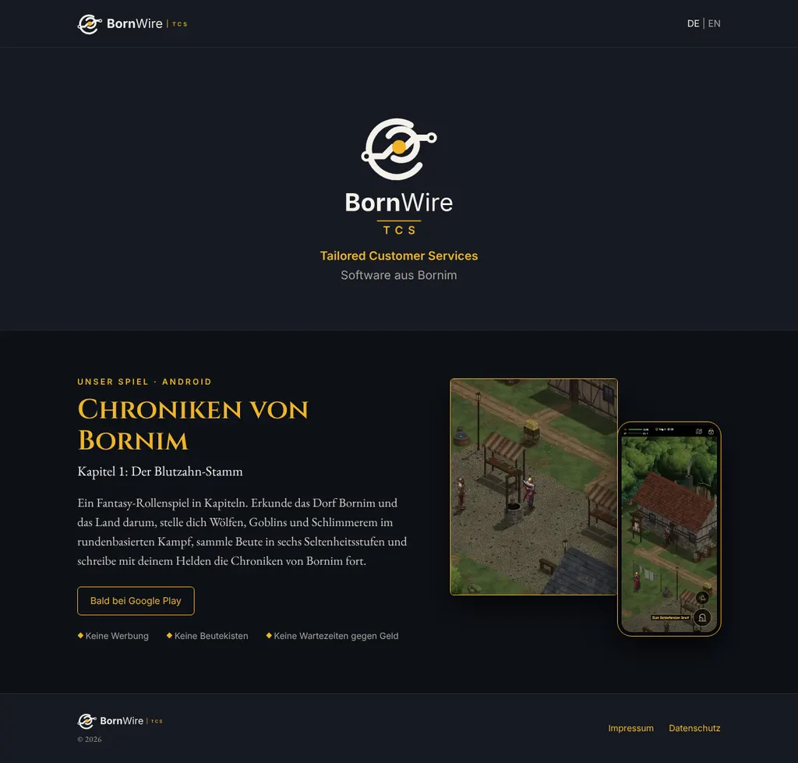
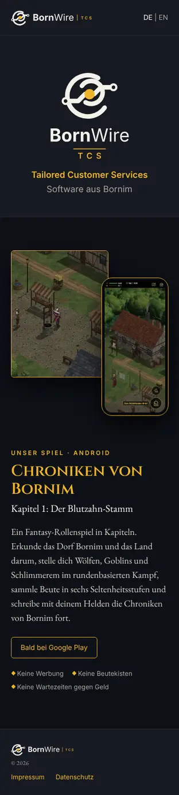

# 252.1 · Webseite bornwire.de, Entwurf · Homer · 24.10., 21:59

Dieselbe Seite am Handy (zum Vergleich, keine zweite Spalte): 

**Eine Seite:** oben das Logo quer (wie im Spiel, `docs/firma/logo/quer-dunkel.svg`) und der Umschalter DE/EN; darunter das Logo hoch mit „Tailored Customer Services“; Abschnitt „Chroniken von Bornim“ mit Kapitelname, dem Text aus „Über das Spiel“ (wortgleich), „Bald bei Google Play“ und den drei Versprechen (keine Werbung, keine Beutekisten, keine Wartezeiten gegen Geld); unten links klein das Logo mit „© 2026“ wie im Hauptmenü, rechts Impressum und Datenschutz. Quelle: `docs/firma/webseite-entwurf-2521.html` (Bau Sokrates).

**Geändert nach deinem Wort (21:56):** Copyright nicht mehr ausgeschrieben, sondern Logo klein mit „© 2026“; „Spiele“, „Über uns“, „Kontakt“ gestrichen. Das Bild rechts im ersten Entwurf war die Handyansicht derselben Seite, keine Leiste; jetzt getrennt.

**Noch nicht drin:** englische Fassung, Inhalte von Impressum und Datenschutz (Sokrates). Die Bilder sind Platzhalter (Markt = linke Hälfte des Vergleichsbilds 302.d1); für die echte Seite je ein Bild vom Kampf (MARS) und vom Dorf aus dem neuesten Build.

**Achtung Name:** Das Gewerbe heißt laut `ARBEIT-BERATUNG.md` Zu 142 „Wirestorm TCS“; im Impressum muss der eingetragene Name stehen.

**Was du sagen sollst:** „252.1 so“ oder was anders soll.
