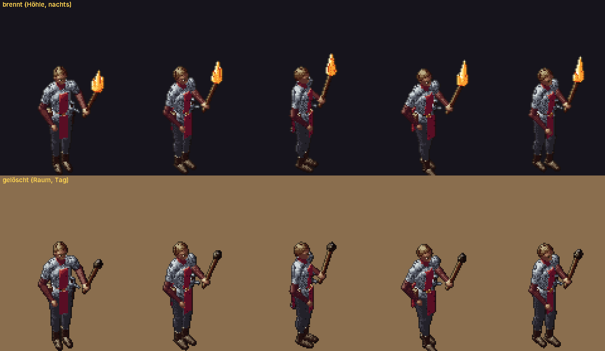

# 255 · Fackel ohne Flamme, Leuchtfunke an der Schulter · Tom · 20.10., 18:11

Dein Wort 17:55: „255 1 und 2“. Standbild vor dem Build, wie entschieden.

- **Fackel:** brennt draußen nachts und in der Höhle. In jedem Grundriss (auch nachts) und draußen am Tag hält der Held sie gelöscht: Stock mit dem Kopf aus Werg, Spitze schwarz verkohlt, keine Flamme, kein Lichtschein. Keine Meldung beim Betreten; auch das Anlegen im Raum sagt nichts.
- **Leuchtfunke:** im Grundriss sinkt er weich (0,7 s) auf Schulterhöhe neben den Kopf, kleiner und matter, ohne Schein auf dem Boden; draußen steigt er wieder über den Kopf. Er brennt weiter bis zur Rast.
- Nebenwirkung: Grundrisse zählen nachts nicht mehr als dunkel (dort gab es ohnehin keinen Nebel und keine Monster).

Oben brennend (Höhle, nachts), unten gelöscht (Raum, Tag); drei Richtungen im Stand, zwei Schritte des Gangs, dreifache Kartengröße:

Fährt im nächsten Tom-Build mit (Zweig `claude/tom-255-fackel-hell`, auf Build 48). Ein Wort genügt: „passt“ oder was anders sein soll.
