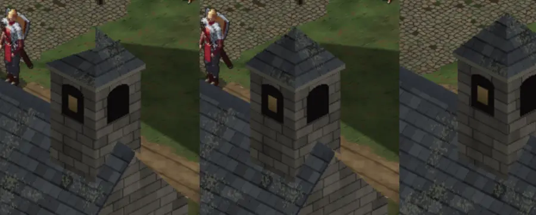

# 269 · Tempelturm: Spitze und Stand auf dem Dach · Tom · 20.10., 23:35

Dein Wort 23:01: „Tempeldach und Turm wirken falsch“. Befund im Code:

- **Spitze:** eine der beiden Dachflächen der Turmspitze zielte neben die Mitte, darum die schiefe, abgeschnittene Spitze. Behoben: beide Flächen treffen sich in einem Punkt (Pyramide).
- **Stand:** der Turm stand am Ostende so dicht am Giebel, dass die Dachkante des Giebels quer vor seinem Fuß lag („rechtes Dachstück stößt quer“). Entwurf: Turm einen halben Feld weiter nach innen; er wächst jetzt aus dem Dach, keine Kante schneidet ihn. Sein Schatten wandert mit.

Links Build 51, Mitte nur die Spitze behoben, rechts Spitze und Turm weiter innen (anderer Standort des Helden):

Fährt im nächsten Tom-Build mit (Zweig `claude/tom-53-busch-tempel`, mit 216.3 Busch an der Wäscheleine). Ein Wort genügt: „passt“, „nur Spitze“ oder was anders sein soll.
