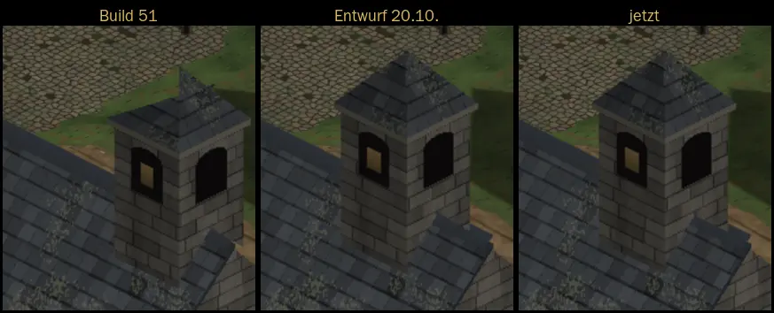

# 269 · Tempelturm: Spitze und Stand auf dem Dach · Tom · 21.10., 07:02

Dein Wort 20.10., 23:01: „Tempeldach und Turm wirken falsch“; Rückläufer 21.10., 06:40: hängt die rechte hintere Kante des Turms in der Luft?

**Ja, in Build 51 hing sie.** Befund im Code:

- **Spitze:** eine Dachfläche der Turmspitze zielte neben die Mitte. Behoben: Pyramide.
- **Stand:** der Turm stand so weit am Ostende, dass seine rechte Wand über das Haus hinausragte; darunter war Boden zu sehen. Jetzt einen halben Feld weiter innen, ganz auf dem First.
- **Fuß der rechten Wand:** sie wurde nur an der Dachfläche abgeschnitten, nicht am First davor. Hinter dem First zeichnete sie darum zu tief. Jetzt endet sie genau am First, wie ein Turm, der aus dem Dach wächst.

Gleicher Standort, ganzer Turm: links Build 51, Mitte Entwurf von gestern (Bild 3), rechts jetzt.

Fährt im nächsten Tom-Build mit (Zweig `claude/tom-53-busch-tempel`, mit 216.3 Busch an der Wäscheleine). Ein Wort genügt: „passt“ oder was anders sein soll.
