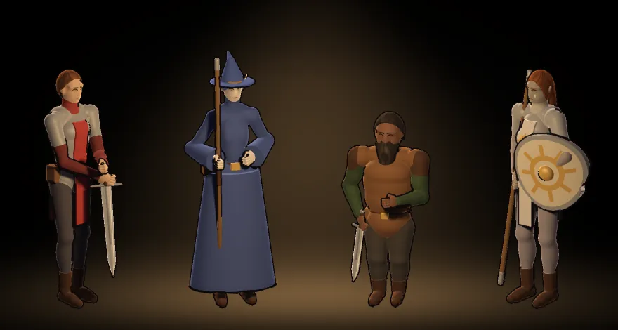

# 292.3 · Hauptmenü: letzter Entwurf A
Tom · 22.10., 15:40 · G Stil · Bild, kein Build

Nach deinem Auftrag 15:12 (über Sokrates), echt aus dem Spiel gezeichnet (Vorschau `TITLEA=1`, Zweig `claude/tom-2923-titelmodus`):
- schwarzer Grund ohne Sterne, warmer Lichtkegel von oben mit Kern in der Mitte und Schein am Boden, stufenlos;
- Außenfiguren zur Mitte gedreht, Abstände gleich, Waffen ruhend, Zwerg kleiner;
- ohne Raster, doppelt gerechnet, Tuschelinie, keine Augenpunkte (nur Lid und schwache Iris), Kantenlicht.

Noch offen: Kantenlicht schwach, Tuschelinie am Schild der Klerikerin klecksig; die Klerikerin (Halbork) wirkt blass und grau (Hautfarbe der Völker ist Aussehen, ändere ich nur auf dein Wort).

**Frage:** So ins Menü bauen, oder vorher etwas ändern?
