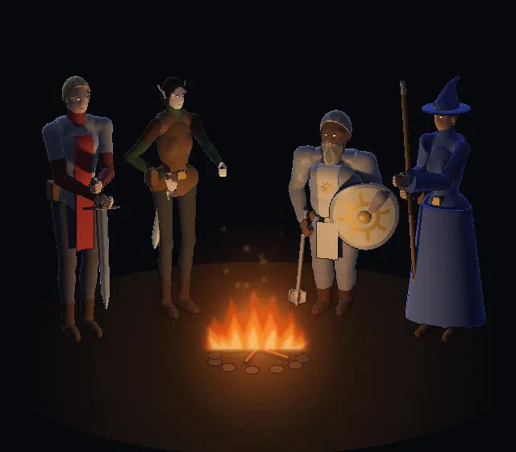
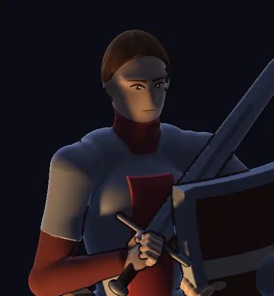

# 292.3 · Entwurf 5: Helden am Feuer im Titelmodus
Tom · 22.10., 14:30 · G Stil · Bild, kein Build

Gezeichnet mit dem echten Spiel, im neuen Titelmodus: Licht nur vom Feuer, mit weichem Schatten und ohne Raster, kühles Gegenlicht aus der Nacht an den Kanten, Tuschelinie (dick im Dunkel, fein im Licht). Dazu ein Gesicht aus Formen (Mandelauge, Iris, Pupille, Glanzpunkt vom Feuer, Lidstrich, Brauen, Mund), Hände mit Fingern und Daumen sowie Haar und Bart in breiten Strähnen. Das Feuer ist niedrig und breit, mit mehreren Zungen und weichen Rändern.

**Noch nicht gut, weiß ich:**
- Der Kämpfer hält das Schwert neben der Hüfte, nicht vor der Mitte auf den Knauf gestützt.
- Die Schurkin streckt die Hand zum Feuer, das liest sich aber kaum.
- Der Zwerg (Kleriker) ist zu groß und zu hell.
- Das Feuer steht tief, darum liegen die Gesichter oben im Schatten.

Frage: Stimmt die Richtung (Licht, Linie, Gesichter)? Dann richte ich die Haltungen und baue das Feuer bewegt.
