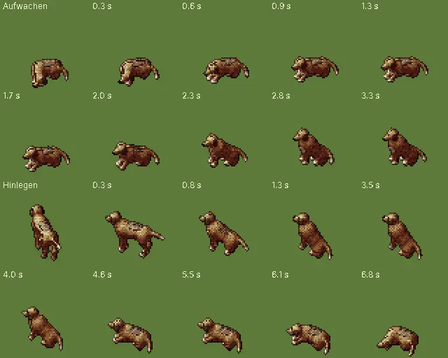

# 293 · Dorfhund weicher · Team Tom · 22.10., 06:50

Oben Aufwachen: hebt erst den Kopf, liegt kurz wach da, setzt sich dann auf (vorher: liegt und sitzt im nächsten Bild). Unten Hinlegen nach dem Weg: dreht sich auf der Stelle zum Liegeplatz, setzt sich, legt sich mit erhobenem Kopf, dann Kopf auf die Pfoten.

Außerdem ohne Bild: Übergänge in 16 statt 8 Schritten mit sanftem An- und Auslaufen; dreht an Ecken in Schritten statt um 90° zu springen; hört mit geschlossenen Pfoten auf zu laufen; Schwanz springt nach dem Wedeln nicht mehr; Zwischenbilder werden vorab gezeichnet (Hauptursache: sie kamen bisher zu spät, darum „Bam“).

**Bitte sagen:** „293 passt“ (dann Build) oder was anders sein soll. Zweig `claude/tom-293-hund`.
