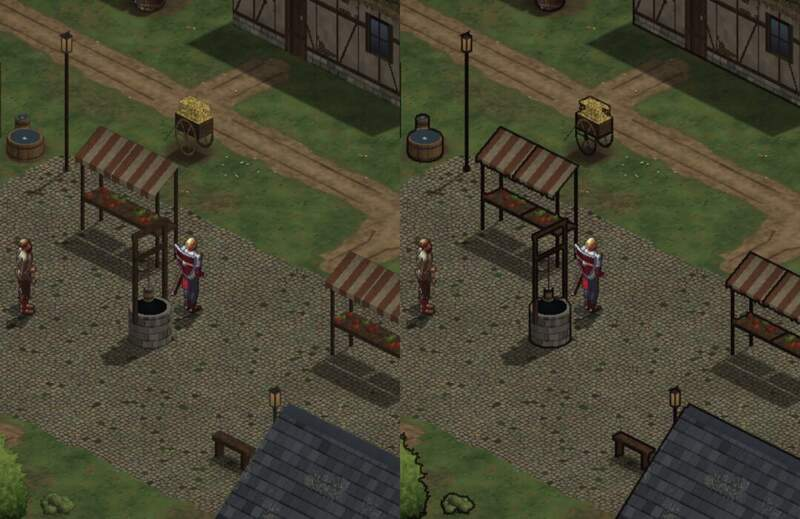
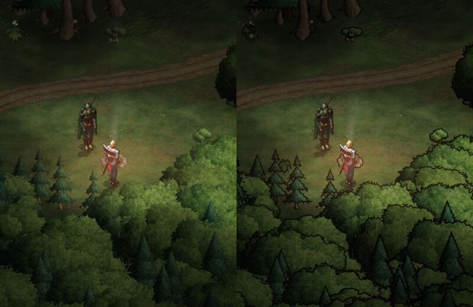
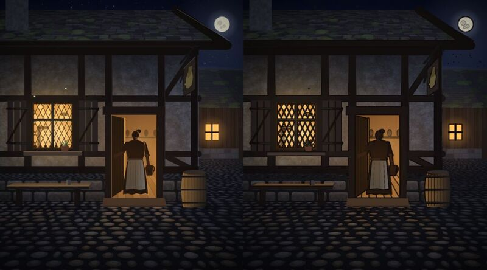

# 302.2 · Tuschelinie Gebietskarte und Zwischenbild, Vergleich · Tom · 23.10., 02:17

Nur Bilder, kein Bau (302.2, 302.3). Je Bild links ohne, rechts mit Tuschelinie, halbe Handygröße. Vergrößerte Ausschnitte (dreifach): Telegram 23.10. 02:17.

**Dorf (Markt, Mittag):** Linie um Stände, Brunnen, Laterne, Fässer, Häuser; Boden ohne.

**Wald:** Linie um Kronen, Nadelbäume, Büsche; Boden ohne. Am deutlichsten, im dichten Laub etwas unruhig.

**Intro Bild 4 (Rowena in der Tür):** Linie an allen harten Kanten (Fachwerk, Fenster, Tür, Rowena); Fenster leuchten etwas weniger.

Bekannt (nur Probe): die Funken im Wald werden mit Linie dunkel; im Intro sitzt die Linie stellenweise neben dem goldenen Lichtrand. Beides wäre beim Bau zu lösen.

**Was du sagen sollst:** Karte mit Linie ja, nein oder „nur Bäume/nur Häuser“; Zwischenbild ja oder nein. Ein Umbau über beide Teams wäre danach eine eigene Chefsache.
