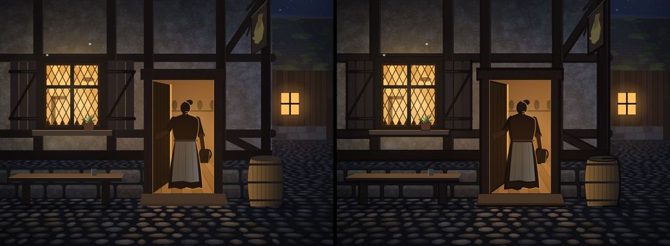

# 302.2 · Tuschelinie Gebietskarte und Zwischenbild, Vergleich · Tom · 23.10., 07:50

Nur Bilder, kein Bau (302.2, 302.3). Je Bild links ohne, rechts mit Tuschelinie, halbe Handygröße. Vergrößerte Ausschnitte (dreifach): Telegram 23.10. 02:17.

**Dorf (Markt, Mittag):** Linie um Stände, Brunnen, Laterne, Fässer, Häuser; Boden ohne.

**Wald:** Linie um Kronen, Nadelbäume, Büsche; Boden ohne. Am deutlichsten, im dichten Laub etwas unruhig.

**Intro Bild 4 (Rowena in der Tür), neu gezeichnet (302.3, 23.10., 07:50):** Linie im Zeichner, nicht als Filter: Umrisse beim Malen, auf der Schattenseite dicker (linke Kante der Balken, Unterkante von Schwelle, Bank, Fensterbank, Fass rechts), im Licht dünn; wo Licht aus Tür und Fenster fällt, keine Linie. Das Licht kommt danach darüber: Fenster gleich hell (gemessen), Rowenas warmer Lichtrand rechts unverändert, ihre Linie nur links.

Bekannt (nur Probe): die Funken im Wald werden mit Linie dunkel; beim Bau zu lösen. Linienstärke einstellbar (`TUSCHESTAERKE`, jetzt 2,2).

**Stellungnahme Sokrates** (23.10., 08:38; Pixelprüfung eines Helfers):
- *Intro 4 neu:* Fenster und Rowenas rechter Lichtrand bleiben gleich hell (hellstes 1 %: 198,6 ohne wie mit Linie). Die Linie wirkt nicht mehr wie ein Filter, aber auch nicht gezeichnet: überall 1–2 Pixel gleich dick, und dass sie im Schatten dicker ist, sieht man in dieser Größe nicht. Ausrutscher: links schluckt sie den 2 Pixel breiten Lichtspalt zwischen Türblatt und Rowena (Mittel 141 → 131).
- *Stärkstes Gegenargument:* Nur 2,7 % der Pixel ändern sich deutlich. Auf dem Handy sieht man den Unterschied kaum, die Linie trägt also noch keine Signatur.
- *Empfehlung:* Zwischenbild: „ja, aber kräftiger“ (Linie im Schatten sichtbar dicker, im Licht keine). Karte: nein vor dem Meilenstein (302.1).

**Was du sagen sollst:** Karte mit Linie ja, nein oder „nur Bäume/nur Häuser“; Zwischenbild ja oder nein. Ein Umbau über beide Teams wäre danach eine eigene Chefsache.
