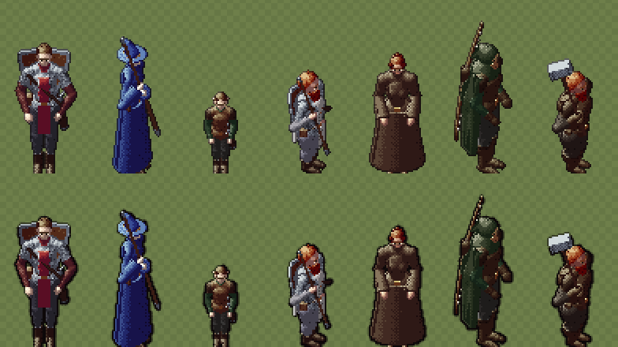

# 302.1 · Tuschelinie für Menschengestalten · Team Tom · 22.10., 22:22

Oben wie bisher (gleichmäßiger dünner Umriss), unten mit Tuschelinie nach der Signatur (`DESIGN-STIL.md` 2): Umriss im Schatten dicker (bis etwa 2 Bildpunkte), im Licht dünner. Gilt für alle Menschengestalten (Held, Leute, Goblins, Grak, Untote), auf der Karte und im Kampf; Tiere nach dem Meilenstein.

- Innenlinien wie im Hauptmenü sind abgeschaltet: bei Figurengröße der Karte verschmierten sie Gesichter und Hände.
- Zeichenzeit des Helden am Rechner 3 bis 9 % länger (Bedingung 267: höchstens 10 %).

Bitte sagen: „passt“ (fährt im nächsten gemeinsamen Build), „kräftiger“, „feiner“ oder „nicht“.
