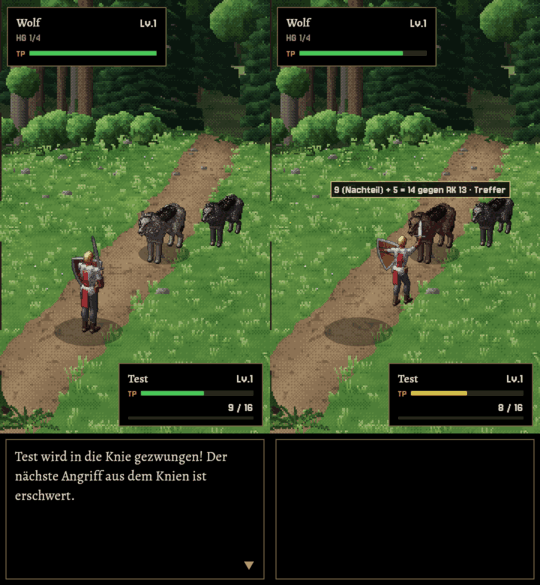

# 309 · Klassischer Kampf zeigt den Wurf, Nachteil aus dem Knien
Jerry · 22.10., 16:07 · E Kampf · Bild, kein Build

Aus dem echten klassischen Kampf (Kämpfer gegen Wolf, deutsch):
1. **Links:** der Wolf zwingt den Helden in die Knie. Text noch alt: „Der nächste Angriff aus dem Knien ist erschwert.“
2. **Rechts:** der nächste Hieb des Helden. Über dem Wolf steht die Würfelzeile wie im MARS-Kampf: „9 (Nachteil) + 5 = 14 gegen RK 13 · Treffer“.

Neu: jeder Treffer und Fehlschlag im klassischen Kampf zeigt seinen Wurf über dem Getroffenen, auch die Bisse des Wolfs gegen den Helden. Vorteil und Nachteil stehen am Wurf, wie bei MARS (Homer zu 309: „Klassisch muss ‚Nachteil‘ am Wurf nach dem Abknien zeigen“). Der Schalter Würfel an/aus aus dem MARS-Kampf gilt auch hier; einen eigenen Knopf hat der klassische Kampf noch nicht. Die Würfelzeile ändert sich mit 313 (Schrift nach 292.3) in beiden Kämpfen zugleich.

Nach „passt“: Homers Zeile `[303.knie]` ersetzt den Regeltext („… muss sich schwer auf die Waffe stützen.“), dann fährt das mit 310 und 311 im nächsten Build.

Bekannt, unverändert seit 295: der Held steht zum Hieb erst auf, dann schlägt er; das Abknien beginnt erst nach der Zeile.

Frage: Passt das so, und soll der klassische Kampf einen eigenen Würfelknopf bekommen?
