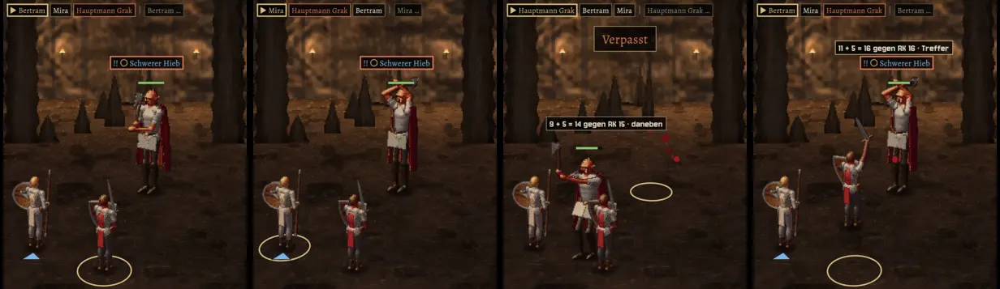

# 310 · Grak holt sichtbar aus
Jerry · 22.10., 15:15 · E Kampf · Bild, kein Build

Aus dem echten Kampf (MARS-Probe, Format A56, Zeitlupe), von links nach rechts:
1. **Ruhe**, gerade angesagt („!! Schwerer Hieb“ über ihm).
2. **„Schwerer Hieb“ angesagt:** Grak reißt die Axt hinter den Kopf und hält sie dort, leicht atmend, bis er zuschlägt, auch wenn er inzwischen getroffen wird.
3. **Der Hieb** geht von hinter dem Kopf aus, ohne vorher in die Ruhe zu fallen.
4. **Neue Ansage:** wieder ausgeholt. Wird der Hieb vereitelt, senkt er die Axt auf demselben Weg.

Berührt `DESIGN-STIL.md`: gehaltene Haltung bleibt stehen, bis die nächste Meldung sie auflöst (`DESIGN-ABNAHME.md` „Selbst prüfen“). Übergänge Ruhe ↔ ausgeholt ↔ Hieb ↔ Senken im Sprungtest. Nebenbei behoben: beim Hochreißen hing die Axt in einem Bild verkehrt herum, mit dem Blatt an der Hüfte.

Frage: Passt das so? Dann baue ich es in den nächsten Build.
