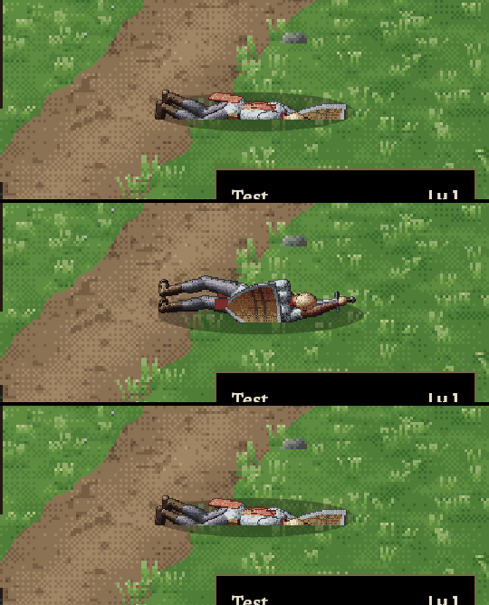

# 311 · Toter Held liegt flach auf der Wiese
Jerry · 22.10., 15:41 · E Kampf · Bild, kein Build

Aus dem echten klassischen Kampf (Alrik gegen Wölfe, Testmodus „sofort verloren“), jeweils das letzte Bild:
1. **Sturz 1:** fällt nach vorn und liegt quer im Bild. Vorher stand er schräg in der Luft.
2. **Sturz 2** (dein Bild, „Variante 1“): liegt flach auf dem Rücken. Der Schild liegt auf der Brust, das Schwert neben dem Kopf. Vorher ragte der Schild wie ein Flügel hoch, die Sohlen zeigten zu dir.
3. **Sturz 3:** dreht sich weg und sinkt zusammen, kompakt, mit dem Rücken zu dir.

Bei allen drei Stürzen wandert der Schatten beim Fallen mit und liegt unter dem Körper (vorher verschwand er).

Ursache: die Figur fiel in die Bildtiefe. Unter der Kampfkamera, die von schräg oben schaut, sah das schräg aus, wie schwebend. Jetzt dreht sie sich im Fall, sodass sie quer zum Bild zu liegen kommt. Berührt `DESIGN-STIL.md` (Figur steht und liegt auf dem Boden, Schatten am Boden). Übergang Stehen ↔ Fallen ↔ Liegen im Film geprüft.

Frage: Passt das so? Dann baue ich es mit 310 in den nächsten Build.
