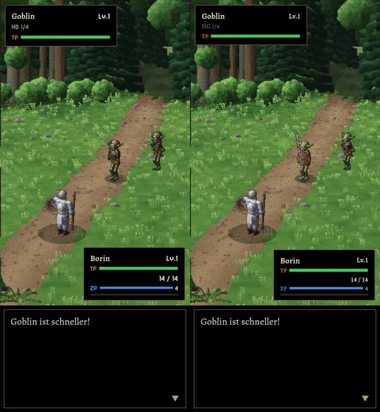

# 313 · Schrift im Kampf nach 292.3, auch klassisch · Jerry · 22.10., 17:05
Jerry · 22.10., 17:05 · E Kampf · Bild, kein Build

Gebaut nach „292.3 ja“ (16:43) und dem Entwurf von Sokrates (Vergleichsbild MARS in 292.3 Schrift):
1. **MARS:** Lebens- und Zauberpunkte und Würfelzeile in Alegreya mit gleich breiten Ziffern; Kästen deckend schwarz mit dünnem Rand; in der Zugleiste ein Held am Zug golden, ein Gegner am Zug rot (im Entwurf war auch der Gegner golden).
2. **Klassisch (Bild):** „Lv.“, „HG“, TP, ZP und die Zahlen der beiden Kästen auch in Alegreya statt Pixelschrift, damit die Schrift im ganzen Spiel gleich ist (Chef 13:54 „einheitlich für alle Schriftarten“). Die Würfelzeile aus 309 ist dieselbe wie in MARS.

Karten bleiben, wie entschieden. Fährt mit 309, 310, 311 im nächsten Build.

Frage: Passt der klassische Kampf so, oder dort die Pixelzahlen lassen?
