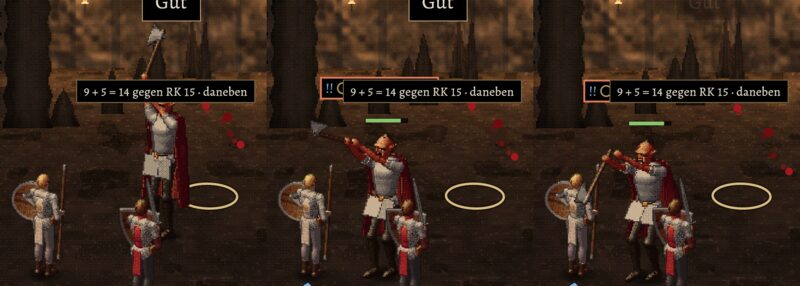

# 320 · Graks schwerer Hieb, Bildserie (2. Fassung) · Jerry · 23.10., 12:15

Nur Bilder, kein Build (228). Antwort auf deine Rückmeldung von 09:17 („Axtblatt gedreht … Haltung unnatürlich … eine Hand nicht an der Axt“). Zweig `claude/jerry-336-ring` (cfdb7449), Vorschau MARS gegen Grak.

Von links: Ausholen (Axt senkrecht über dem Kopf; so hält er sie von der Ansage bis zum Hieb, wie um 09:17 gebilligt), Herabschwingen, Zwischenbild, Aufschlag, Durchziehen; ganz rechts der Aufschlag in der Kampfszene.

- **Neu:** beide Hände in jedem Bild am Stiel; beim Aufschlag Fäuste auf Bauchhöhe, Oberarme am Rumpf, nichts mehr vor dem Gesicht, Kopf zum Ziel gesenkt, Schneide nach unten; nach dem Treffer zieht die Axt weiter nach unten durch; ein Zwischenbild mehr, damit der Stiel nicht von oben nach unten springt.
- **Bekannt (fremder Prüfer):** im Ausholen, Herabschwingen und Zwischenbild liegen Arme und Hände vor dem Gesicht; das Zwischenbild (Stiel waagrecht) wirkt für sich allein wie ein Stoß, in der Bewegung ist es nur ein kurzer Augenblick. In der Szene liegt der Stiel flacher als im Einzelbild, das Blatt landet neben Kopf und Schulter des Helden, nah an seinem erhobenen Schwert; das kann wie eine Abwehr wirken. Das Doppelblatt (Großaxt, wie die Beute, die er hinterlässt) zeigt im Seitenblick beide Flügel. Der weiße Schurz wirkt kantig und sitzt beim Durchziehen seitlich versetzt. Beim Vorspringen auf den Helden wirft Grak keinen Schatten.

**Stellungnahme Sokrates** (12:32; Chef 12:30: „Hände über Kreuz … mit einer Axt kein Holz spalten … vielleicht ist es eh so schnell, dass es keiner sieht“):
- *Was man sieht:* Der Hieb dauert 0,9 s. Herabschwingen und Zwischenbild sieht man kaum. Das **Ausholen hält er aber von der Ansage bis zum Hieb**, und **Aufschlag und Durchziehen** stehen am Ende kurz still. Diese Haltungen sieht jeder Spieler bei jedem Grak-Kampf, und genau dort liegen laut Prüfer Arme vor dem Gesicht.
- *Empfehlung:* Eine letzte Runde, nur für die zwei stehenden Haltungen: Hände nebeneinander am Stiel, die obere Hand zum Blatt hin, nie gekreuzt (wie beim Holzspalten); im Ausholen die Arme neben dem Kopf, nicht davor. Zwischenbilder so lassen. Danach ist Schluss: Was dann noch stört, kommt mit dem neuen Zeichnen der Figuren (302.1), nicht als weitere Runde.
- *Stärkstes Gegenargument:* Grak sieht man nur im MARS-Probekampf und in zwei Kämpfen in Kapitel 1. Und das ist schon die dritte Runde, im Sparbetrieb. Darum nur diese eine Runde und kein Build dafür allein; sie fährt im nächsten Sammelbuild mit.

**Was du sagen sollst:** „passt“ (fährt im nächsten Build) oder was anders sein soll.
