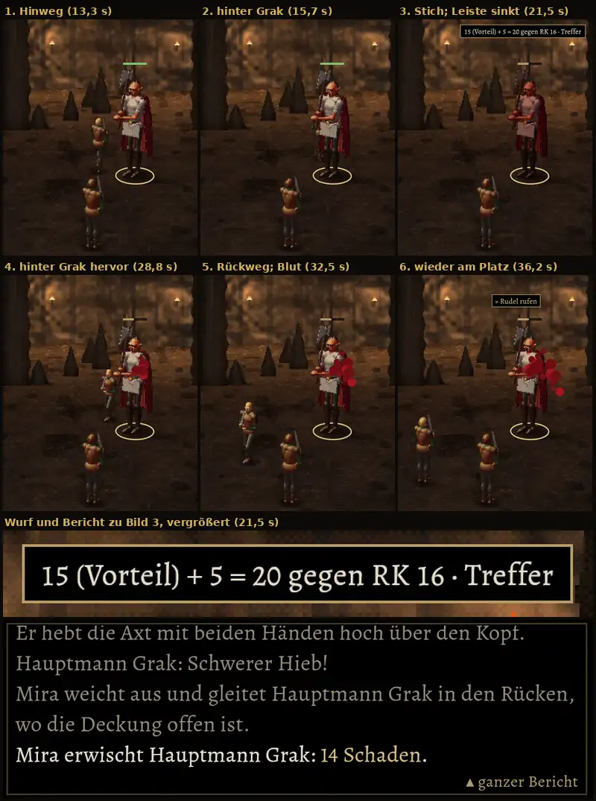

# 336 · Schurke sticht nach perfektem Ring · Jerry · 23.10., 19:44
E Kampf

MARS, Mira (Schurke) gegen Grak: Sie fängt den Schweren Hieb mit perfektem Ring, geht seitlich an Grak vorbei und sticht verdeckt hinter ihm (wie Vorgang 336a, dein Wort 18:20). Graks Lebensleiste sinkt; Wurfanzeige und Berichtszeile „14 Schaden“ erscheinen erst, wenn die Klinge trifft. Sie kommt mit Gesicht zur Kamera zurück und dreht sich erst an ihrem Platz in der hinteren Reihe um. Vorn steht Söldner Bertram; „Rudel rufen“ oben im sechsten Bild ist Graks nächste Absicht. Zeitlupe zehnfach langsamer.

Bekannt, nicht geändert: Blut erscheint erst kurz nach dem Stich und wächst lange (Blutbild wie von dir abgenommen).

**Sag „passt“, dann baue ich den Build mit 337, 336 und 344.1/345 von Team Tom.**
