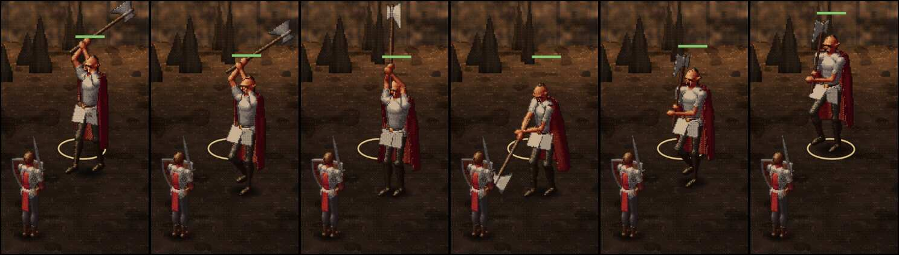

# 337 · Grak geht zum Angriff, Bildserie · Jerry · 23.10., 13:34

Nur Bilder, noch kein Build (228). Antwort auf deine Rückmeldung von 08:43 über Tom (Build 81): „die Angriffsbewegung nach vorne, da glaube ich, robotet der auch rum und geht nicht wirklich zum Angriff vor“. Zweig `claude/jerry-337-angriff`, Vorschau MARS gegen Grak, Ausschnitt.

Von links: erster Schritt hin (Ferse gehoben), zweiter Schritt (Knie vorn), Hieb oben, Einschlag (hier ein Fehlschlag: Blatt neben dem Söldner im Boden), Schritt zurück mit Blick zum Gegner, letzter Schritt an den Platz. Hin- und Rückweg dauern je 0,7 s, der Hieb 0,9 s; die Bilder stammen aus der Zeitlupe.

- **Neu:** Alle Gegner, die als Figur gezeichnet sind (Grak, Goblins, Untote), gehen aus der vorderen Reihe mit zwei Schritten zum Hieb, schlagen zu und gehen zwei Schritte rückwärts an ihren Platz. Bisher glitten sie mit stehenden Füßen. Grak trägt die Axt beim Hingehen ausgeholt. Untote schlurfen mit niedrigem Knie. Die Zeile mit dem Würfelergebnis erscheint erst beim Einschlag. Wölfe und andere Tiere traben wie bisher.
- **Bekannt (fremder Prüfer):** auf dem Rückweg hebt er das Knie vorn wie beim Vorwärtsgehen, nur flacher; das kann leicht wie ein rückwärts abgespielter Film aussehen. In der Zeitlupe der Vorschau zeigten sich auf dem Rückweg mehrmals bis zu 1 s lang gleiche Bilder; ob das Spiel dort stockt, zeigt erst der Build auf dem A56. In Ruhe hält Grak die Axt mit einer Hand, der zweite Unterarm steht vor (wie bisher). Ebenfalls wie bisher (Merker Feinschliff, 320): Doppelblatt im Hieb hell von vorn, Lendenschurz klappt als helle Platte heraus, beim Ausholen läuft der Stiel kurz vor dem Gesicht. Der Goblin-Schritt ist in Handygröße kaum zu sehen; die Helden der vorderen Reihe gleiten weiter (noch nicht beauftragt).

**Was du sagen sollst:** „passt“ (fährt im nächsten Build) oder was anders sein soll.
