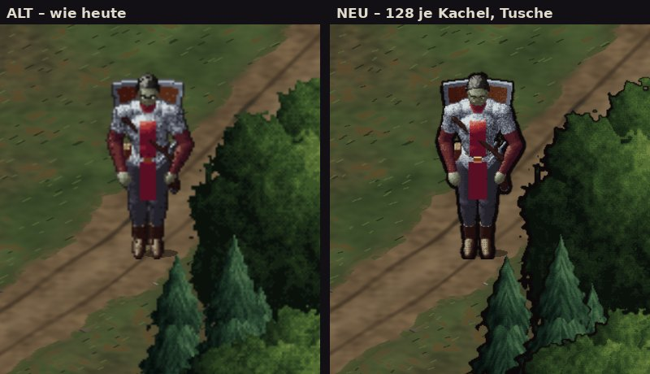
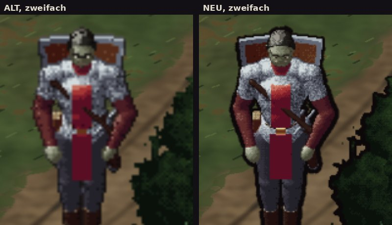

# 348.1 · Vergleichsbild Gebietskarte alt und neu · Tom · 24.10., 17:14
E Technik · zu [348](../entscheiden/348-engine.md) · Zweig `claude/tom-3481-vergleich` (Vorschau `VERGLEICH348=1`)

Großbild: Telegram 24.10. 17:14

**Sag:** „neu gefällt“ oder „weiter wie bisher“.

## Was du siehst

- Links **wie heute**, rechts **doppelt so fein, mit Tusche**; beide vom eigenen Zeichner, keine Engine. Flüsterwald, Held auf dem Weg, schräg und im Maßstab wie am Handy, ohne Tageslicht und Fackel; Glättung wie im Spiel.
- **Heute sind es schon 64 Bildpunkte je Kachel**, nicht 32: Boden, Bäume und Held werden doppelt fein gezeichnet. „Neu“ ist der Schritt von 64 auf 128, also vierfacher Speicher, nicht sechzehnfacher wie in 348 angenommen.
- Auf beiden Seiten weggelassen: Büsche, Farne, Stümpfe, Baumschatten (ihr Zeichner kann noch nicht feiner).
- Tusche: Umriss an Bäumen und Held, an den Bäumen im Schatten dicker, im Licht dünner; im Zeichner gezogen, nicht als Filter.
- Rechts schärfer: Gesicht, Kettenhemd, Gras, Zweige; die Tusche wird erst hier sichtbar.
- Offen aus der Fehlerprüfung: am Helden ist die Tusche überall gleich dick, eher ein dunkler Hof als ein Strich; an der Eiche und neben dem Helden wenige lose dunkle Pünktchen; Baumränder teils sägezahnhart. Beim Bauen zu beheben, für die Geschmacksfrage unerheblich.

## Gemessen am Rechner

| | heute (64) | neu (128) |
|---|---|---|
| Boden, 20 Stücke um den Helden (drei Läufe) | 0,6 s, 5 MB | 2,9 s, 20 MB |
| Bäume im und um den Ausschnitt (neu zwei Läufe) | 0,3 s, 8 MB | 2,5 s, 30 MB (mit Tusche) |
| Held, ein Bild | 0,03 s | 0,1 s |
| Boden ganze Karte, alles behalten | 10 MB | 40 MB |
| alle Bilder des Helden | 18 MB | 74 MB |

Am Handy geschätzt drei- bis fünfmal langsamer: der Boden um den Helden bräuchte neu etwa 9 bis 15 s statt 2 bis 3 s. Heute reicht der Speicher knapp (346: Absturz bei 509 von 512 MB). **Neu geht vermutlich nicht ohne Umbau aufs Handy:** Bilder nur bei Bedarf zeichnen, weniger vorhalten oder den Grafikchip nutzen (in der jetzigen App oder mit Engine).

## Danach

„neu gefällt“ → Sokrates prüft den Weg aufs Handy, dann die Fehlermessung (348). „weiter wie bisher“ → Kapitel 1 fertig, Frage nach dem Meilenstein neu.
