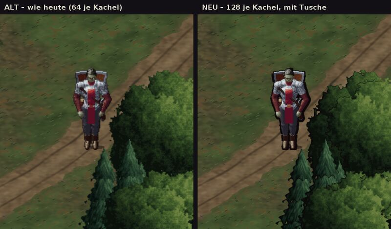
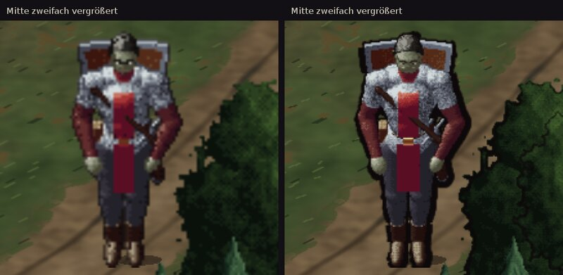

# 348.1 · Vergleichsbild Gebietskarte alt und neu · Tom · 24.10., 17:14
E Technik · zu [348](../entscheiden/348-engine.md) · Zweig `claude/tom-3481-vergleich` (Vorschau `VERGLEICH348=1`)

Großbild: Telegram 24.10. 17:14

Antwort unten unter 348.2 (gilt für beide Bilder).

## Was du siehst

- Links **wie heute**, rechts **doppelt so fein, mit Tusche**; beide vom eigenen Zeichner, keine Engine. Flüsterwald, Held auf dem Weg, schräg und im Maßstab wie am Handy, ohne Tageslicht und Fackel; Glättung wie im Spiel.
- **Heute sind es schon 64 Bildpunkte je Kachel**, nicht 32: Boden, Bäume und Held werden doppelt fein gezeichnet. „Neu“ ist der Schritt von 64 auf 128, also vierfacher Speicher, nicht sechzehnfacher wie in 348 angenommen.
- Auf beiden Seiten weggelassen: Büsche, Farne, Stümpfe, Baumschatten (ihr Zeichner kann noch nicht feiner).
- Tusche: Umriss an Bäumen und Held, an den Bäumen im Schatten dicker, im Licht dünner; im Zeichner gezogen, nicht als Filter.
- Rechts schärfer: Gesicht, Kettenhemd, Gras, Zweige; die Tusche wird erst hier sichtbar.
- Offen aus der Fehlerprüfung: am Helden ist die Tusche überall gleich dick, eher ein dunkler Hof als ein Strich; an der Eiche und neben dem Helden wenige lose dunkle Pünktchen; Baumränder teils sägezahnhart. Beim Bauen zu beheben, für die Geschmacksfrage unerheblich.

## Gemessen am Rechner

| | heute (64) | neu (128) |
|---|---|---|
| Boden, 20 Stücke um den Helden (drei Läufe) | 0,6 s, 5 MB | 2,9 s, 20 MB |
| Bäume im und um den Ausschnitt (neu zwei Läufe) | 0,3 s, 8 MB | 2,5 s, 30 MB (mit Tusche) |
| Held, ein Bild | 0,03 s | 0,1 s |
| Boden ganze Karte, alles behalten | 10 MB | 40 MB |
| alle Bilder des Helden | 18 MB | 74 MB |

Am Handy geschätzt drei- bis fünfmal langsamer: der Boden um den Helden bräuchte neu etwa 9 bis 15 s statt 2 bis 3 s. Heute reicht der Speicher knapp (346: Absturz bei 509 von 512 MB). **Neu geht vermutlich nicht ohne Umbau aufs Handy:** Bilder nur bei Bedarf zeichnen, weniger vorhalten oder den Grafikchip nutzen (in der jetzigen App oder mit Engine).

## 348.2 · Tusche nach Licht am Helden, Innenlinien an Bäumen · 24.10., 17:50

Zweites Vergleichsbild (Chef 17:36: „ich will das jetzt sehen“); Großbild Telegram 24.10. 17:50.

**Sag:** „neu gefällt“ oder „weiter wie bisher“ (gilt für 348.1 und 348.2 zusammen).

- **Held:** Tusche zur Lichtseite (links) dünn, abgewandt (rechts) dick, nach dem Licht allein statt nach der Kleiderfarbe.
- **Bäume:** Innenlinien zwischen großen Blattballen und unter jeder Fichtenstufe; kleine Stücke weggelassen, sonst sähe es schmutzig aus. **An den Ästen noch keine Linien:** sie liegen hinter der Krone, ihre Kante zur Krone bekommt die Krone; eigene Astlinien beim Bauen.
- **Licht:** Held von links beleuchtet, Bäume von rechts, schon heute im Spiel so. Welche Seite gilt, ist eine eigene Frage für die ganze Karte; die Tusche folgt jeweils dem Licht ihrer Figur.
- Offen aus der Fehlerprüfung: Tusche am Helden weich wie ein Hof, nicht hart; ein kleiner Ring oben in der Eichenkrone, treppige linke Kronenkante; fast schwarze Flächen zwischen Fichten und Busch. Beim Bauen zu beheben, für die Geschmacksfrage unerheblich.

Kosten, gemessen am Rechner:

| je Bild | ohne Tusche | Umriss (348.1) | 348.2 |
|---|---|---|---|
| Eiche, 128 je Kachel | 44 ms | 61 ms | im Ganzen gemessen, s. u. |
| Fichte, 128 je Kachel | 10 ms | 20 ms | im Ganzen gemessen, s. u. |
| Held, 128 je Kachel | 59 ms | 61 ms | 65 ms |

- **Bäume um den Helden:** 2,5 s mit Umriss (348.1), 2,8 s mit 348.2; am Handy drei- bis fünfmal langsamer, also etwa 8 bis 14 s. Bei 64 je Kachel (heute) ist die Tusche kaum zu sehen, darum nicht eigens gemessen.
- **Held:** Einzelmessungen schwanken um einige ms, so viel wie die Tusche kostet: praktisch gleich.
- **Speicher: gleich.** Die fertigen Bilder bleiben so groß wie in 348.1; beim Zeichnen kurz ein Hilfsfeld unter 1 MB.
- **Arbeit bis spielreif:** etwa 1 Arbeitstag für die Tusche (Fehler oben, Äste, ins Spiel), dazu der Weg aufs Handy (348).
- **Gegenargument:** Noch ein Tag Arbeit an einer Feinheit, die vermutlich erst mit dem Umbau aufs Handy kommt; bis dahin geht Kapitel 1 vor.

## Danach

„neu gefällt“ → Sokrates prüft den Weg aufs Handy, dann die Fehlermessung (348). „weiter wie bisher“ → Kapitel 1 fertig, Frage nach dem Meilenstein neu; die Heldentusche nach Licht kann dann mit 302.1 (Tusche an allen Menschengestalten) kommen, das entscheidest du dort.
