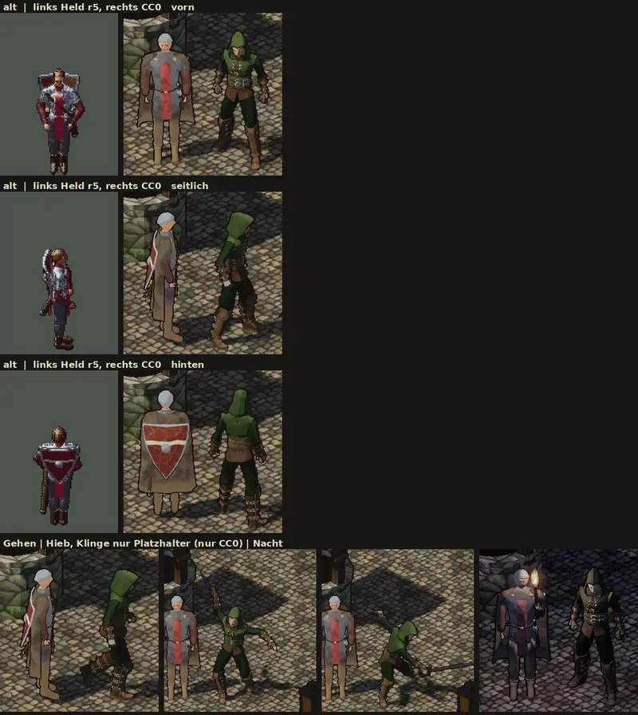

# 348.12 · Probe: fertiger CC0-Grundkörper neben Held r5 · Jerry · 25.10., 22:34

**Sag:** „übernehmen“ (fremdes Knochengerüst mit seinen Bewegungen, Körper und Kleidung weiter selbst darauf), „ganz übernehmen“ (auch Körper und Kleidung, umgefärbt) oder „weiter selbst“ (Probe verwerfen).

Zeilen 1–3: links der alte Held, daneben in Godot im Dorf links **Held r5** (selbst gebaut, Runde 5), rechts die **Probe** (fertiger freier Körper) von vorn, seitlich, hinten. Zeile 4: Gehen, zweimal Hieb, Nacht; Held r5 steht daneben, nur die Probe bewegt sich; die **Klinge ist ein Platzhalter**; nachts trägt nur Held r5 eine Fackel. Dein Wort 21:36: „348.12 ja, Probe bei Tom“; übernommen von Jerry, weil Tom an 348.6 sitzt. Großbild: Telegram 25.10. 22:34.

**Gemacht:** alles von Quaternius, Lizenz CC0 1.0 (Lizenzdatei in jedem Paket nachgesehen): Kopf mit Gesicht und Augen aus „Universal Base Characters“, Kleidung „Waldläufer“ aus „Modular Character Outfits – Fantasy“ (ohne Schulterstück), 8 Bewegungen aus der „Universal Animation Library“. Per Skript umgebaut: Feinheit von 30.200 auf 5.880 Dreiecke (unsere Grenze fürs Handy 6.000), Haut wie beim Helden, Farben gedämpft, ohne Glanz; 1,75 m, mit Kapuze 1,80 m. Licht und Tuschelinie wie im Spiel.

**Befund (Helfer, drei Runden):** Körperbau und Bewegung der Probe sind deutlich besser: Gelenke, natürlicher Stand, echte Schritte, glaubwürdiger Hieb; Held r5 wirkt daneben „wie eine Puppe mit Säulenbeinen“. Die Probe ist dunkler und passt eher zu „düster, erwachsen“; keine Löcher nach dem Verkleinern. Dagegen: ein anderer Mensch (Waldläufer grün-braun statt Rot und Silber), die Kapuze ist auf der Sonnenseite frisch grün, die Probe steht in Ruhe leicht eingedreht, die Tuschelinie ist an Händen und Schnallen stufig. Behoben in Runde 1–2: Schulterstück stand ab, Gesicht nachts fahl, Klinge lag quer vor dem Bauch.

**Diogenes:** frei, nicht heller und nicht bunter als alt (Helligkeit −14 bis −24 %, Sättigung +1 bis +11 %; das Silber fehlt). Befunde: Gesicht halb Haut, halb braun wie eine Naht (Kapuzenschatten); kein eigener Schlagschatten der Figur erkennbar; im Hieb ist eine Pose verdreht und die Klinge einmal am Rand abgeschnitten. Gehen und Nacht plausibel, „erwachsen und matt, nicht comicartig“.

**Homer** (gegen die gebilligte Abnahmeliste Held): der fremde Körper ist die bessere Grundlage, düsterer als Runde 5, die „wie ein steifer Pappkegel“ wirkt; wie gezeigt fällt er aber durch Punkt 3 und 4 (liest sich als Waldläufer statt Kämpfer, grün statt rot-silber) und Punkt 5 (die Kapuze verschattet Augen und Brauen); glatt, mit klobigen Händen, „leicht wie aus einem Asset-Paket, nicht niedlich“.

**Was frei ist und was fehlt:**
- Frei: 2 Körper (Mann, Frau, beide athletisch), je 2 Kleidungen (Waldläufer, Bauer), 5 Frisuren, 1 Bart, 2 Brauen; 43 Bewegungen, davon 11 unbrauchbar (Pistole, Schwimmen, Tanzen, Fahren, Grundstellung); brauchbar u. a. Stehen, Gehen, Laufen, Rennen, Schwerthieb, Zauber, Sprung, Faustschlag, Treffer, Tod, Fackel, Sitzen, Sprechen, Hocken, Rolle, Aufheben. Die „über 250“ Bewegungen gibt es nur gegen Geld.
- Fehlt frei: Abwehr (nur Bereitstellung mit Schwert), Stich, Ausweichen (nur als Rolle), Rüstung, Kleider für 13 Dorfleute und vier Klassen; Zwerg, Halbling, Halbork (frei gibt es nur große Menschen; ob das Knochengerüst sie trägt, ist nicht geprüft).
- Der Hieb dauert 1,5 s, unser Maß ist 0,8 s; schneller abspielen geht, ist aber nicht geprüft.

**Votum Jerry:** „übernehmen“: das fremde Knochengerüst und seine Bewegungen bringen den größten Vorsprung, Körper und Kleidung bauen wir weiter selbst, dann aber auf diesem Gerüst. Das bricht zwei unserer Modellregeln: 4 (eigenes Knochengerüst) und 5 (Bewegungen im eigenen Skript); die Feinheit (Regel 7) halten wir ein. Die Ausnahmen legt Sokrates gesondert vor. **Stärkstes Gegenargument:** Tom hat Held und Leute schon auf dem eigenen Gerüst mit Körperreglern (348.10); ein Wechsel kostet ihn den Umbau aller Figuren, fehlende Bewegungen (Stich, Abwehr) müssten wir trotzdem selbst bauen, und wir hängen an einem fremden Stil.

**Berührt:** 348.6 (Held und Leute, Tom), 348.7 (Goblin und Kampf, Jerry), 348.10 (Körperregler), 348.11 (Abnahmelisten), Modellregeln 4, 5 (`LISTE-UMZUG-348.md`).
