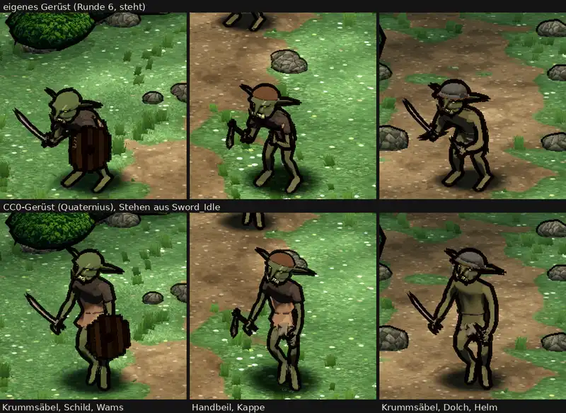

# 348.12 · Goblin auf dem CC0-Gerüst, Probe · Team Jerry · 26.10., 15:35

Oben unser Goblin auf dem eigenen Gerüst (`rig.py`, Runde 6), unten derselbe Goblin auf dem CC0-Gerüst (Quaternius, Stehen „Sword_Idle“). Großbild: `bilder:pruefung/348.12-goblin-cc0-r1.png`.

**Sag „eigen“ (Gerüst bleibt, Grak und Zombie nicht auf CC0) oder „cc0 nochmal“ (zweite Probe mit geduckter Pose, eine Sitzung).**

Votum Jerry: eigen. Unten steht der Goblin aufrecht, bei 1 und 2 mit X-Beinen und heller, nackt wirkender Haut zwischen Wams und Schritt, die Waffen hängen, beim dritten liegt der Dolch vor dem Schritt (anstößig); oben steht er geduckt, die Waffen nach vorn. Unten wirkt er größer, weil die aufrechte Figur auf dieselbe Breite gebracht ist; die echte Größe ist gleich. Für CC0 sprechen die saubereren Gelenke an Armen und Beinen (im Großbild).

Stärkstes Gegenargument: Das Blatt vergleicht die Haltung, nicht das Gerüst (Diogenes 15:14). Eine geduckte CC0-Bewegung könnte gleichziehen; sie kostet eine Sitzung.

Geprüft: Prüfer (eigen überzeugender) und Diogenes 15:14 (frei mit Befunden: unten 1 bis 5 % dunkler als oben, Sättigung gleich; beide Reihen ohne Hauer, Fell, Rost). Großbild: Telegram 26.10., 15:3x.
