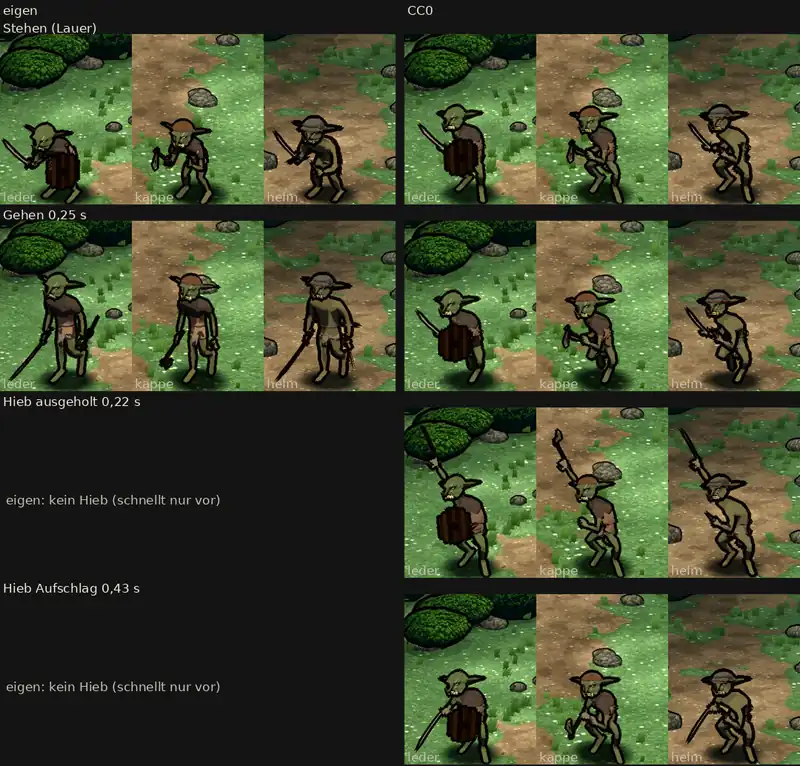

# 348.12 · Goblin-Hieb Runde 7: abnehmen? · Jerry · 27.10., 16:49

**Frage:** Das ist der CC0-Goblin nach deinem „CC0“ vom 27.10., 09:49. Es gibt ihn in drei Ausrüstungen: Leder (Schwert und Schild), Kappe (Beil) und Helm (Schwert und Dolch). Nachgebessert sind Aufschlag, Ausholen, Faust und Beil. Die Schilde sind noch nicht nachgebessert: Kappe hat keinen Schild, Helm trägt einen Dolch statt eines Schilds. Ist der Hieb so abgenommen? Dann bauen wir Grak, Kobold und Zombie auf dasselbe Gerüst. Oder soll ich noch etwas ändern?

**Votum Jerry: „passt“.** Die offenen Punkte unten behebe ich beim Übertrag auf Grak, Kobold und Zombie, zuerst die Schilde und den Rückweg. Stärkstes Gegenargument: Auf dem Schirm wirkt der Aufschlag wie ein Schlag von oben bis zum Boden, nicht wie ein Schlag nach vorn (unten erster offener Punkt).

Bitte den [Film](bilder:pruefung/348.12-r7-film.mp4) ansehen, links eigen, rechts CC0. Das Blatt in voller Größe liegt [hier](bilder:pruefung/348.12-r7-blatt.png).

**Berührt:** Grak, Kobold, Zombie (348.12), Kampfort in Godot (348.7).

## Sachverhalt

**Geändert seit Runde 6 (im Modell gemessen):**
- **Ausholen:** Die Faust ist 0,4 m über dem Kopf und 0,4 m außen, die Klinge zeigt schräg nach hinten oben.
- **Aufschlag:** Der Arm ist gestreckt, die Faust auf Schulterhöhe. Die Klinge zeigt etwa 22° abwärts zum Gegner (Prüfer 22°, mein Modell 24°), die Schneide nach unten.
- **Lauer:** Die rechte Faust ist auf Brusthöhe, nicht mehr vor dem Mund.
- **Kappe:** Ihr Beil ist größer, die Schneide misst 12 statt 8 cm.
- **Ansage:** Der Goblin sagt jetzt „Hieb“ an statt „Stich“ (Homer).

**Fremde Prüfung (27.10., 16:44, Blatt und Film Bild für Bild):** kein Befund „hoch“, 6 Befunde „mittel“, hier in 4 Punkten zusammengefasst.
- **Behoben:**
  - Ausholen: Die Faust ist bei allen drei über und neben dem Kopf. Bei Helm sieht man die Hand, die Klinge wächst nicht mehr aus seinem Kopfschutz.
  - Faust vor dem Mund: weg, in der Lauer (Leder, Helm) und beim Aufschlag (Leder).
  - Leder: Die Klinge ist beim Aufschlag ganz vor dem Schild zu sehen.
  - Helm: Die Klinge liegt beim Aufschlag nicht mehr vor den Beinen.
  - Kappe: Das Beil ist klar als Beil zu erkennen.
  - Blatt: nichts abgeschnitten, kein Nachbar in einer Kachel, Beschriftung richtig.
- **Offen (mittel):**
  - Aufschlag auf dem Schirm: Gewollt ist ein gestreckter Schlag nach vorn zum Gegner. Die Kamera schaut von oben, darum sieht man die Faust auf Brusthöhe statt auf Schulterhöhe, den gestreckten Arm sieht man nicht, und die Spitze endet auf Fußhöhe. Es wirkt wie ein Schlag von oben bis zum Boden, nicht wie ein Stich. Ob das so bleiben darf, entscheidest du.
  - Rückweg 0,50–0,70 s: Die Waffe ist bei allen drei praktisch nicht zu sehen, weil die Klinge zur Kamera zeigt.
  - Im Gehen treten die Goblins in der Probe auf der Stelle. Ob sie im Kampf vorwärts laufen, habe ich nicht geprüft.
  - Die beiden Helden, die zum Vergleich daneben stehen, machen im Film 0,07 s lang einen Schritt und springen dann in den Stand zurück. Die Ursache kenne ich noch nicht.
- **Offen (gering):**
  - Helm im Gehen: Der Dolch liegt quer über dem Unterarm der Schwerthand. Ob er durch den Arm sticht, ist bei der Auflösung nicht zu entscheiden.
  - Bei 0,30–0,33 s liegt die Klinge bei Helm und Leder waagrecht auf Kopfhöhe. Im Ablauf wirkt es als Bogen.
  - Kappe: Ihr Stiel liegt beim Aufschlag vor dem rechten Oberschenkel, der Beilkopf neben dem Knie. Die Faust sitzt in der Mitte des Stiels, das Stielende ragt 10 px über die Faust.
  - Kappe beim Ausholen: Der Beilkopf reicht auf dem Schirm bis an die Füße von Helm und überdeckt sie.
  - Leder beim Ausholen: Die dunkle Klinge liegt vor dem dunklen Busch und hat kaum Kontrast.
  - Helms Dolch ist kaum zu sehen, weil er an der Schwerthand liegt.
  - In Spielgröße sind die Goblins klein: 9–12 % der Schirmhöhe, die Helden etwa 18 %.
  - Im Blatt endet die Spitze von Leder beim Aufschlag 3 px über der Beschriftung.
  - Die letzten 0,67 s des Films stehen still (Fehler beim Schnitt).

**Messung Diogenes (27.10., 17:0x, nur Hinweis):** Eigen und CC0 sind gleich hell, im Stehen ±2 %, im Gehen −3 bis +7 % (Helm +7 %). Das Paar im Gehen ist ungleich: Der eigene ist dort ohne Schild und in anderer Haltung.

**Sag:** „passt“ (oder „ja“): so übernehmen, die offenen Punkte behebe ich beim Übertrag. Sonst sag, was anders sein soll.
