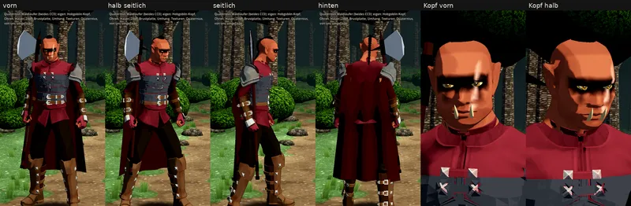

# 348.12 · Grak, Gestalt Runde 2: neu aus freien Quaternius-Teilen · Team Jerry · 28.10., 10:38

**Frage:** Ist Grak so auf dem richtigen Weg? Sag „Grak ja“, dann baue ich an dieser Gestalt weiter; sonst sag, was anders sein soll.

**Bitte ansehen:** [Film](https://cdn.jsdelivr.net/gh/tramour-cmyk/androidapp_rpg_bornim@bilder/pruefung/34812-grak-gestalt-r2.mp4), 14 s: ganzer Körper auf Augenhöhe, eine Drehung (0–8 s), dann der Kopf nah, noch eine Drehung (8–14 s). So beleuchtet und gezeichnet wie im Spiel, auf der Lichtung des Kampforts. Er zeigt nur die Haltung „Stehen“; Gehen und Hieb ruhen bis zu deinem Ja (08:10).

**Deine Frage (08:09: „Welches Modell läuft da? Welche Texturen?“):**
- Bisher (Blatt von 05:47): unser eigener, im Programm gebauter Körper, ohne Texturen, nur Flächenfarben.
- Jetzt: Kopf vom freien Quaternius-Modell „Superhero“; Körper mit Händen, Mantel, Gürteln, Armschienen, Hose, Stiefeln und Schulterstück von der freien Quaternius-Waldläufer-Tracht (beides CC0, aus dem Bestand). Texturen von Quaternius, von uns umgefärbt: Haut rotbraun, Mantel dunkelrot, Leder und Stiefel dunkel, Augen bernsteinfarben, Kriegsbemalung, Narbe.
- Selbst gebaut: Kopfform des Hobgoblins (breiter, platte Nase, schwere Stirn), spitze Ohren, Hauer, Haarknoten mit Zopf, Brustplatte, zweites Schulterstück, Umhang. Die Großaxt ist die bisherige.
- Die gekauften Teile (mehr Köpfe, Ritterrüstung mit echter Halbplatte) konnte ich in dieser Sitzung nicht laden (fehlende Zugriffsrechte). Darum stammt die Tracht aus dem freien Paket.

**Was der fremde Prüfer in Runde 1 gefunden hat und was ich geändert habe** (Runde 2 hat kein Prüfer mehr angesehen; nach einer Fehlerrunde urteilst du, 373):
- Der Zopf war eine Kette einzelner Kugeln, am Scheitel lag ein schwarzer Keil. Jetzt ist er eine Röhre mit Flechtwülsten, 1 cm über dem Hinterkopf, das Haar schwarzbraun.
- Die Oberkante der Bemalung war ein Sägezahn. Jetzt läuft sie weich.
- Die Narbe war nicht zu sehen. Jetzt ist sie breiter und heller und liegt auf der Haut.
- Der Rumpf wirkte braun wie Leder. Jetzt sind Mantel und Ärmel dunkelrot.
- Die Stiefel waren hellbraun, die Schulterstücke grell weiß. Jetzt sind die Stiefel fast schwarz und der Stahl dunkler.
- Die Faust saß 2–3 cm neben dem Axtstiel. Jetzt geht der Stiel durch die Faust und steht unten 8° nach außen, sonst stak er im Stiefel.
- Der hintere Hauer stand neben der Wange in der Luft. Jetzt sitzt er tiefer im Kiefer und ist kürzer.
- Eine Gürtellasche lag außen auf dem Umhang, der Stiefel stach durch den Saum. Jetzt hängt der Umhang weiter vom Körper weg.
- Im Film zeigte die erste Sekunde den Kampf, die letzte war leer, und die Schrift lag über den Füßen. Das ist behoben.
- Gemessen statt angesehen: Die Axt ist 4–6 cm von Bein, Stiefel und Rumpf entfernt. Beide Hauer liegen vor der Haut.

**Noch offen von früher:** Der Kampfort zeichnet Grak 1,32-mal so groß wie gebaut, aus 186 cm werden etwa 2,45 m. Im Film ist er so groß.

**Danach:** Nach deinem Wort baue ich die Kobolde neu. Ob auf dieselbe Art, hängt von deinem Urteil hier ab.
