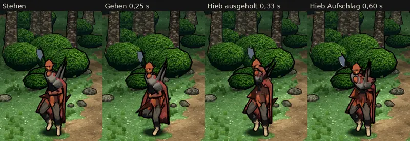

# 348.12 · Grak auf dem CC0-Gerüst, erster Entwurf: noch nicht fertig · Team Jerry · 28.10., 01:50

**Morgenblatt.** Das ist der Stand nach den zwei erlaubten Probeläufen (389). Grak ist noch nicht fertig. Ich lege ihn vor, weil die Grenze erreicht ist, nicht weil er gut ist.

**Bitte nur ansehen.** Antworte „Grak ja“, wenn ich die Befunde unten beheben soll, oder sag, was anders sein soll.

**Was gebaut ist:**
- Grak ist 186 cm groß, mit Zopf 191 cm.
- Er trägt eine Halbplatte mit Schulterstücken über dem Steppmantel, dazu Hose, Stiefel und einen roten Umhang.
- Die Großaxt ist neu.
- Seine Bewegungen sind Stehen, Gehen und ein Hieb mit beiden Händen von oben.

**Was der fremde Prüfer gefunden hat** (offen):
- Die Axt liegt in keiner Hand. Die linke Faust ist 48–68 cm vom Stiel entfernt, der Stiel läuft schräg durch Rumpf und Umhang. Beim Hieb bewegen sich nur die Arme, die Axt bleibt stehen. Die Ursache liegt bei mir: Die Haltung habe ich auf dem fremden Gerüst entworfen, sie überträgt sich nicht auf Graks andere Glieder.
- Grak steht geduckt mit einem angehobenen Fuß statt aufrecht, der Kopf ist gesenkt.
- Über der rechten Schulter stehen zwei graue Kegel wie Hörner. Das Schulterstück ist falsch geformt.
- Im Spielbild fehlen Kopfmerkmale aus der Liste: breites Gesicht, Hauer, Zopf, Bemalung, Narbe.
- Im ganzen Kampfbild (nicht im Blatt) wirkt Grak neben der Heldin nicht größer als sie. Er steht weiter hinten.
- Die Füße wirken im Bild hell wie nackt, obwohl er Stiefel trägt.
- Der Steppmantel wirkt eher rostorange als dunkelrot.
