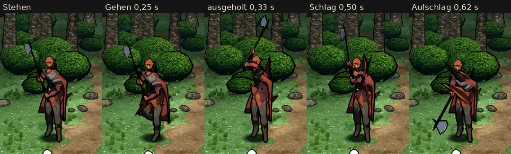

# 348.12 · Grak auf dem CC0-Gerüst, Runde 2: noch nicht fertig · Team Jerry · 28.10., 03:25

**Morgenblatt.** Ersetzt das Blatt von Runde 1 (01:50). Das ist der Stand nach den zwei erlaubten Probeläufen (389). Grak ist noch nicht fertig.

**Bitte ansehen:** [Film](https://cdn.jsdelivr.net/gh/tramour-cmyk/androidapp_rpg_bornim@bilder/pruefung/348.12-grak-r2-film.mp4), Stehen, Gehen, Hieb. Antworte „Grak ja“, wenn ich die offenen Fehler unten beheben soll, oder sag, was anders sein soll.

**Behoben seit Runde 1:**
- Die Axt liegt in beiden Händen, auch im Hieb (gemessen: Fäuste 0–3 cm am Stiel).
- Grak steht aufrecht, der Kopf ist nicht mehr gesenkt.
- Die Füße sind nicht mehr sandbeige. Ursache war heller Schlamm in der Bemalung von Stiefeln und Hose.
- Die Schulterstücke sitzen jetzt starr am Oberarm. Vorher verbogen sie sich im Hieb um bis zu 10 cm.
- Erst nach dem Film behoben, darum dort noch zu sehen: Die Axt stand beim Übergang von Gehen in den Hieb ein Bild lang kopfüber. Der Oberarm drehte sich dabei um seine eigene Länge, bis zu 140° in 0,1 s.

**Was der fremde Prüfer gefunden hat** (offen, Bildstellen im Blatt):
- Beim Aufschlag: eine graue Sichel und ein rotes Dreieck quer vor der Brust. Ein schwarzer Kegel läuft von der Schulter am Gesicht vorbei. Die Ursache ist noch offen.
- Der rote Umhang sticht durch die Halbplatte. Rechts ragt ein roter Zacken aus dem Umhang, beim Ausholen steht einer über der Schulter.
- Beim Schlag (0,50 s) liegt die linke Hand frei vor der Brust, davor ein schwarzes Strichknäuel.
- Nach dem Aufschlag springt Grak in 0,1 s zurück in die Stehhaltung. Der Aufschlag hält nur 0,2 s.
- Grak wirkt 1,3-mal so groß wie die Heldin. Bei etwa 170 cm für die Heldin sind das rund 220 cm statt 186 cm. Ursache: Der Kampfort zeichnet Goblins und Grak wie bisher 1,32-mal so groß wie gebaut (`kampfort.gd`). Soll das für Grak so bleiben?
- Die Stiefel sind graubraun statt schwarz, die Halbplatte ist grau.
- Kopfmerkmale (Bemalung, Narbe, Zopf, Augen) waren nicht prüfbar. Die Nahaufnahme zeigt die Brust statt des Kopfes, der Fehler liegt in der Probe. Ein Hauer reicht als gelber Strich vom Auge bis zum Kinn.
- Im ganzen Kampfbild steht an einem Platz ein beiger Zylinder. Das ist ein Fehler der Probe am Rechner: Dort fehlten die Goblin-Modelle. Im Spiel kommt er nicht vor.

**So entworfen, zur Kenntnis:** Die rechte Faust liegt 63 cm unter der Schneide, die linke 38 cm tiefer am Stiel. Der Stiel ist 142 cm lang.
