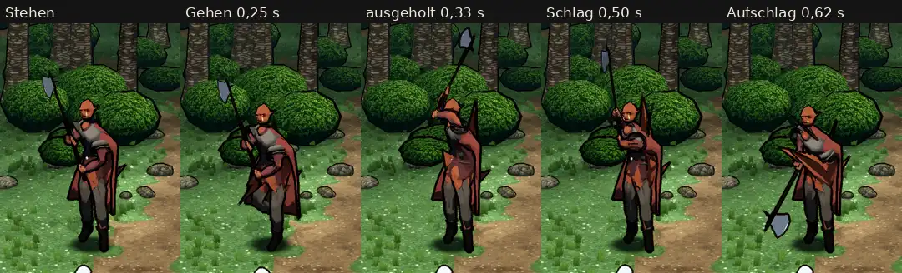

# 348.12 · Grak auf dem CC0-Gerüst, Runde 3: noch nicht fertig · Team Jerry · 28.10., 05:47

**Morgenblatt** (zum Ansehen am Morgen). Ersetzt das Blatt von Runde 2 (03:25). Das ist der Stand nach den zwei erlaubten Probeläufen (389: höchstens zwei Läufe je Vorlage). Gerüst = die freien Gelenke und Bewegungen (CC0), auf die wir die Figur setzen. Grak ist noch nicht fertig, die meisten Fehler aus Runde 2 sind noch da.

**Bitte ansehen:** Film auf Telegram (348.12, Grak), Stehen, Gehen, Hieb. Antworte „Grak ja“, wenn ich weiter an den Fehlern unten arbeiten soll, oder sag, was anders sein soll.

**Frage aus Runde 2, noch offen:** Grak wirkt 1,3-mal so groß wie die Heldin. Bei etwa 170 cm für die Heldin sind das rund 220 cm statt der gebauten 186 cm. Ursache: Der Kampfort zeichnet Goblins und Grak 1,32-mal so groß wie gebaut. Soll das für Grak so bleiben?

**Behoben** (laut fremdem Prüfer):
- Im zweiten Probelauf: Die Stiefel sind fast schwarz. Vorher deckte sie eine Schlammfarbe ganz zu.
- Schon im ersten Probelauf: Der beige Zylinder im Kampfort ist weg, er war ein Fehler der Aufnahme. Beim Übergang vom Gehen in den Hieb steht die Axt nicht mehr ein Bild lang kopfüber.

**Gebaut, ohne sichtbare Wirkung:** Jeder Punkt der Figur bewegt sich mit einigen Gelenken des Gerüsts mit. Bei Grak hingen 470 Punkte an mehr als 4 Gelenken, manche an 11. Das Spiel nimmt nur die 4 stärksten, dadurch lagen Teile bis 9 cm anders als im Bauprogramm. Ein Punkt an der linken Brust zog zu 10 % mit dem rechten Unterarm, 22 Punkte des Umhangs mit den Oberarmen. Jetzt hängt jeder Punkt an höchstens 4 Gelenken, der Umhang an keinem Arm, und Punkte fern vom Arm nicht mehr am Arm. Das Dreieck vor der Brust und der Zacken über der Schulter sind trotzdem geblieben. Die Ursache liegt woanders und ist noch offen.

**Was der fremde Prüfer gefunden hat** (offen):
- Beim Aufschlag liegt ein großes rotbraunes Dreieck quer vor der Brust. Ein dunkler Keil läuft von der linken Schulter am Gesicht vorbei. Ob das der linke Arm mit Ärmel und Schulterstück ist, der beim Zweihandgriff vor der Brust liegt, habe ich noch nicht gemessen.
- Ein roter Zacken steht rechts an der Hüfte. Beim Ausholen, Schlag und Aufschlag steht ein hoher roter Zacken über der Schulter.
- Beim Ausholen ist der Rumpf fast ganz rot und orange, die Platte sieht man kaum.
- Beim Schlag liegt der linke Unterarm frei quer vor der Brust, davor ein dicker schwarzer Ring.
- Nach dem Aufschlag springt die Axt in 2 Bildern (0,07 s) zurück in die Stehhaltung.
- Orange Haut scheint durch die Kleidung: zwischen den Oberschenkeln, an der Hüfte, am rechten Schienbein, beim Aufschlag an Brust und Schulter.
- Der Hauer ist ein hellgelber Streifen, der unter dem Auge beginnt.
- An der linken Hüfte sitzt ein weißer Punkt.
- Die Nahaufnahme zeigt nur ein halbes Gesicht. Narbe, Bemalung und Zopf sind nicht zu erkennen. Hier ist die Kamera der Aufnahme falsch gesetzt, nicht die Figur.
