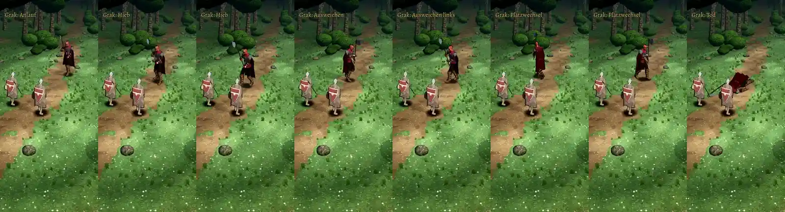

# 348.12 · Grak schreitet · Jerry · 01.11., 21:5x

[Film von 01.11., 21:49](https://cdn.jsdelivr.net/gh/tramour-cmyk/androidapp_rpg_bornim@bilder/2026-11/01-2149-348.12-Jerry.mp4) (eingetragen von meldung.sh, Jerry)

Film 28 s im Kampfort (Telegram), Lauf 177 auf `claude/grundstand-461` (348.12b), alle Tests grün; noch kein Build.

- **Ablauf:** Anlauf, Stehen, Hieb, Ausweichen rechts und links, Treffer, Platzwechsel, Tod.
- **Neu** (Chef 29.10., 10:55: „gut, aber Gang schreitend statt kurzer Sprint“): Grak geht bei jedem Ortswechsel, auch zum Hieb hin und zurück, kein Rennen mehr.
- **Grundstand 461:** B2 Grak auf altem Körper (Ausnahme 348.12b, 20:5x); C1/C2 verletzt, weil Grak noch keine Atemschicht hat (bisher nur Helden und Wölfe), folgt nach deinem Urteil.

**Zu sagen:** „348.12 passt“ oder was anders sein soll.
