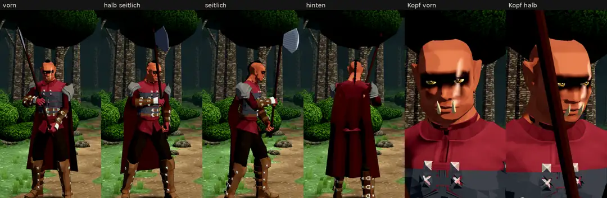

# 348.12 · Grak hält die Axt jetzt mit beiden Händen · Team Jerry · 28.10., 11:53

**Bitte ansehen:** [Film](https://cdn.jsdelivr.net/gh/tramour-cmyk/androidapp_rpg_bornim@bilder/pruefung/348.12-grak-zweihand.mp4), 14 s: Grak dreht sich einmal im Stand, dann der Kopf nah.

**Geändert (dein Urteil 10:57: Axt „hält er irgendwie komisch“, Stiel durch die Schulter):**
- Grak hält die Großaxt wie in der Abnahmeliste mit beiden Händen: rechte Faust vor der Brust unter dem Kopf der Axt, der Stiel steil vor dem Körper, die linke Faust 38 cm tiefer am Stiel, die Schneide nach vorn. Vorher hielt er sie nur rechts, senkrecht neben dem Bein.
- Gemessen über die ganze Standbewegung: Die Axt schneidet weder Schulter noch Arm, Brustplatte oder Körper. Sie berührt ihn nur in den Fäusten. Vorher schnitt sie Arm und Schulter, Brustplatte und Körper.

**Danach:** Gehen, Hieb (beim angekündigten schweren Schlag die Axt über dem Kopf), Treffer und Tod mit dieser Haltung. Dann die Kobolde auf dieselbe Art.

Der Befund des fremden Prüfers kommt nach dem Senden als Text (Archiv 396).
